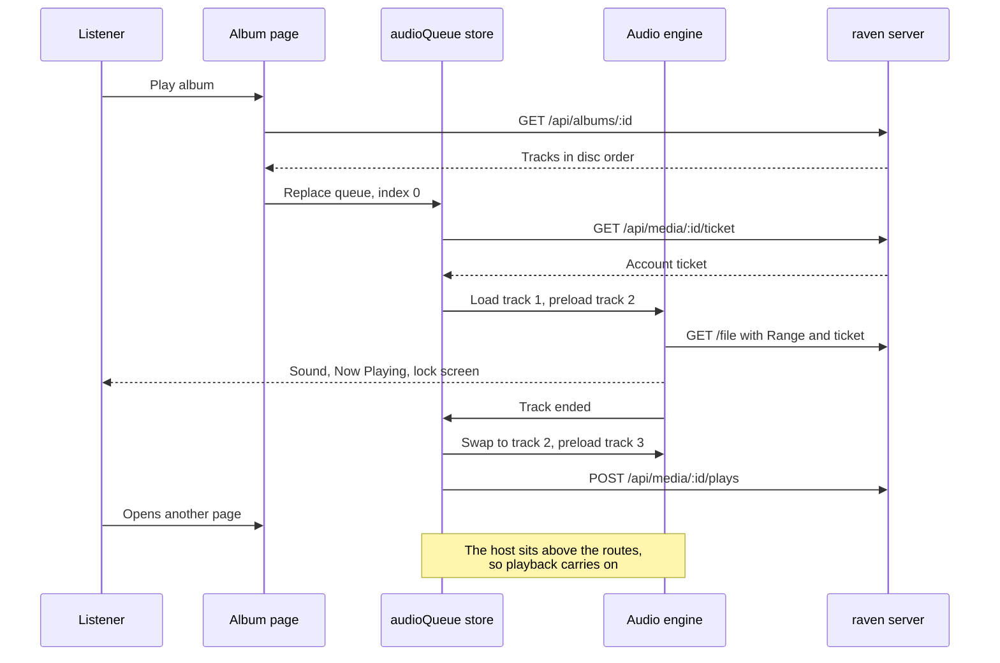
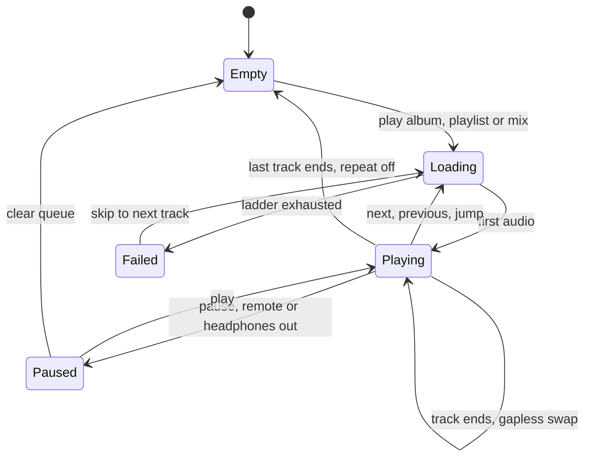
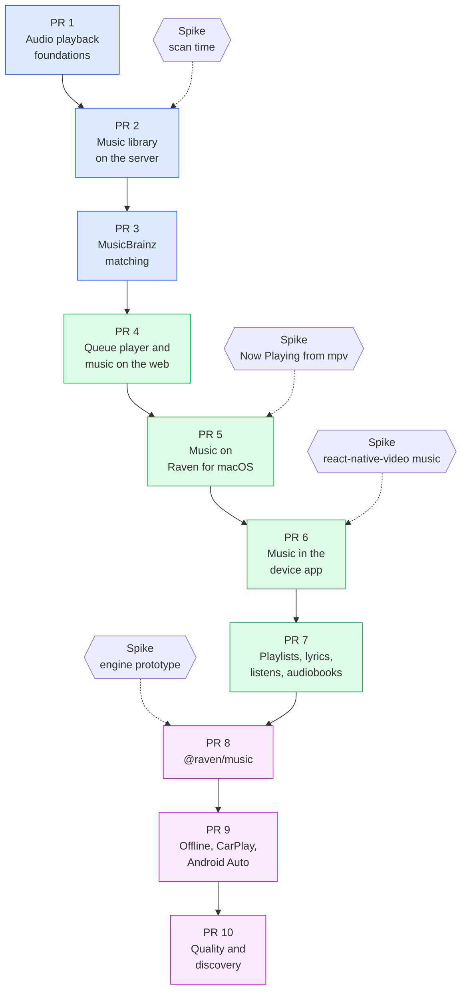

# raven: audio libraries, and a standalone music player

Date: 2026-10-27. Status: approved on 2026-10-27, building as ten PRs; PRs 1 to 4 are built. Written as a spike, its four spikes ran on 2026-10-27 and their results are in section "Spikes".

## Why

raven is a video library and player. Its owner also keeps music (and could keep audiobooks) on the same NAS, and wants two things:

1. **Audio libraries in raven.** A library of music (and later audiobooks and podcasts) is scanned, tagged, browsed and played in every raven client: the web app, Raven on macOS, and the device app on iPhone, iPad, Apple TV and Android TV.
2. **A standalone music player.** A music-first app that competes with Apple Music, Spotify, Tidal and the like on how it feels to use, playing the owner's own library from the same raven server and accounts.

This spike maps what each project does today, what assumes video, what can be reused, and what it would take. Section "Plan" turns it into a stack of PRs.

## Background in brief

- **Nothing in raven handles audio today.** The scanner indexes only `VIDEO_EXTENSIONS`; ffprobe ignores the container's tags (artist, album and so on); `/stream`, HLS and thumbnails all map `0:v:0` and break or refuse on a file with no picture; every match is a TMDB movie or show; and every player is a full-screen page that stops when the viewer leaves it.
- **A good deal is reusable.** Account tickets, the media plane, `/file` with ranges, the desktop's loopback relay, per-account `plays` and progress, `useProgressReport`, the playback ladder, the allowlists' pattern, `KIND_RULES` and the audio icons (`headphones`, `music`, `disc`, `podcast`, `audiobook`) already in `LIBRARY_ICON_NAMES`.
- **Three pieces are new work:**
  - a music data model (artists, albums, tracks, multi-artist credits, discs) beside the TMDB items;
  - a **persistent player with a queue** that lives above the routes in every client;
  - **system integration**: lock screen, Control Center, macOS Now Playing and media keys, Android's media notification, and later CarPlay and Android Auto.
- **The standalone player cannot compete on catalog.** Spotify, Apple Music and Tidal sell licensed catalogs of 100M+ tracks; a self-hosted server has the owner's files. It can compete on what Plexamp, Roon and Doppler compete on: lossless and hi-res, gapless, loudness, lyrics, smart mixes, offline, privacy and no subscription. Section 9 lists the parity bar.
- **Recommended order:** first make the server understand audio, then add a music library to the existing clients behind a shared queue player, then build the standalone app on the same core and server. Ten stacked PRs in all: seven bring music to every raven client, and three build the standalone app.

> [!CAUTION]
> Anti-goal: matching Spotify, Apple Music or Tidal on catalog. Their 100M+ tracks are licensed; raven plays the owner's own files, and nothing in this plan streams music raven does not hold.

## Spike findings

> [!NOTE]
> The findings below come from reading every raven project on 2026-10-27, at `a5135b9d`. Paths are relative to each project's `src` unless they start with `libs/` or `apps/`.

### Server (`@raven/server`)

- **Scanning.** `isIndexed` (`scanner/walk.ts:46`) admits only `VIDEO_EXTENSIONS` (`libs/raven/core/src/media.ts:2-18`). The watcher filters nothing itself, so extending the list is enough for audio to reach `MediaIndex.apply` (`media/mediaIndex.ts:250`). `namedAs` (`media/namedAs.ts:20`) and `groupFolderOf` (`libs/raven/core/src/folderLayout.ts:40`) parse only movie and episode names.
- **Probe.** `parseProbe` (`ffmpeg/probe.ts:148-172`) accepts an audio-only file (it throws only with neither stream), so audio probes cleanly today. It never reads `format.tags`: artist, album, album artist, track, disc, date, genre, MusicBrainz ids, ReplayGain and lyrics are all thrown away. Embedded cover art (`attached_pic`) is spotted only to be excluded (`probe.ts:33,96-101`).
- **Schema.** 37 migrations (`db/database.ts`); the next is index 37. `media` carries `width`, `height`, `video_codec`, `video_bit_depth`, `hdr`, `keyframes`, `thumbnail` and `split`, plus the reusable `duration`, `audio_codec`, `audio_channels`, `bitrate`, `tracks`. `items` is TMDB-bound: `tmdb_id NOT NULL`, `UNIQUE(type, tmdb_id)`, `person_credits CHECK type IN ('movie','show')`. `localItems.ts` already synthesizes `local:` ids, a precedent for non-TMDB ids.
- **Streaming.**
  - `/file` serves any file with ranges, but `containerMimeType` (`libs/raven/core/src/playback.ts:98-114`) knows no audio container, so it answers `application/octet-stream` and clients judge the file unplayable.
  - `/stream` always maps `-map 0:v:0` (`ffmpeg/args.ts:305`) and says `video/mp4` with H.264 (`playback.ts:219`): with no picture it fails after the 200; with cover art it remuxes an mjpeg frame into fMP4.

    > [!NOTE]
    > This spike first read the `0:v:0` map as breaking videos whose first video stream is cover art. Checked in PR 1, ffmpeg lists cover art after the real video in MP4, MOV and Matroska files (an MP4's `covr` atom and an MKV attachment alike), so no video was affected. An audio file with a cover was: `0:v:0` took the picture for its video. PR 1 maps `0:V:0`, which never takes an attached picture, everywhere.

  - HLS refuses with 422 (`hls/hlsController.ts:179`) and is video-shaped throughout (`hlsArgs.ts:236`, `hls/variant.ts:31`, `-select_streams v:0`).
  - Audio transcoding exists only as stereo AAC 192k (`args.ts:309`) beside video.
- **Thumbnails.** One frame grab per file (`ffmpeg/args.ts:43-67`), enqueued for every probed file (`scannerService.ts:627`): audio is marked `failed`, and cover art only comes out by accident.
- **Metadata.** `MetadataService` builds one `KindMatcher` per `MatchItemType` (`metadata/matchers.ts:31-43,286`); `MatchPass` is built with TMDB only (`metadataService.ts:437-446`); the AI matcher's tools are `search_tmdb` and `list_episodes`. Pictures are `item_images` rows with sources `local`, `tmdb`, `chosen`; `PictureVersions.item` signs `item:${id}:${kind}:${source}:${ref}`, so a new source (Cover Art Archive) needs no change there. Image kinds are poster, backdrop, still and logo: there is no square cover.
- **Viewing.** `plays` (with `furthest`), `playback_progress`, `favourites` and `item_favourites` are per account and keyed by `media_id` or `item_id`, so a listen is a play as it stands. `watchedCards.ts:44-47` already anticipates "an album, a playlist".
- **Routes.** A new route needs a lock mark (`@PrivateBy` or `@Public`), `@AdminOnly()` or `@ForViewers()` if it writes, `@MediaPlane()` if it streams bytes, a row in `ROUTES` (`test/enforced.ts:48-152`), and, for the device app, an `APP_CLIENT_CALLS` entry (`libs/raven/core/src/appClientCalls.ts`) that `appClients.test.ts` checks. The enforced fixture builds a movies library (`test/enforced.ts:370`) and needs an audio file too.

### Core and the shared player (`@raven/core`, `@raven/ui`)

- **Contract.** No audio kind in `LIBRARY_KINDS` (`contract/libraries.ts:80-91`), no artist, album or track in `ITEM_TYPES` (`contract/items.ts:39-44`), and `MediaItem` (`contract/items.ts:97-157`) has no tags. `MediaStreams.video` is already nullable "for a file with no picture but cover art" (`contract/tracks.ts:104-105`), and `AudioStream.sampleRate` exists. `KIND_RULES` is `satisfies Record<LibraryKind, KindRules>`, so a new kind fails to compile until it has rules: good.
- **Planner.** `checkDirectPlay` and `planPlayback` already tolerate a null `videoCodec` (`playback.ts:167,282`); `CONTAINERS` (`playback.ts:54`) is mp4, mov, mkv, webm; `HLS_COPY_AUDIO_CODECS` already includes flac and alac. `offeredQualities` and `STREAM_QUALITIES` are frame heights.
- **Player.** The `Engine` (`components/Player/engine.ts:72-74`) is `html` or `native`, which is the right seam. The html engine renders `<video>` and types `HTMLVideoElement` throughout (`useHtmlEngine.tsx`, `useMediaSource.ts`, `useVideoState.ts`, `streamSource.ts`, `canPlay.ts`), but uses only `HTMLMediaElement` APIs apart from the optional stats, so retyping is mechanical. `Stage` is full-screen chrome.
- **Queue.** `WatchState = { media, upNext, isShuffled }` (`itemLinks.ts:121-162`) rides in router state, and `useUpNext` (`useUpNext.ts:38-59`) moves to the next title by navigating, which remounts the player. There is no previous, repeat, queue view or Media Session API anywhere (`navigator.mediaSession` has no hits).
- **Host.** `useHostPlayer` (`stores/playerServices.ts:45-58`) keeps one host's services in a store, so a persistent mini-player and the watch page would contend for it.

### Web (`@raven/web`)

- `/watch/:id` sits outside `AppShell` (`AppRoutes.tsx:75`); `AppShell` (`AppShell.tsx:292-305`) is where a now-playing bar would live.
- The library page picks its listing by kind (`LibraryViews.tsx:27-95`, `listsShows`), its tabs by kind (`librarySections.ts:40-59`), and its toolbar from `sortFieldsFor`, `groupingsFor`, `viewsFor`. An album listing is a third branch beside shows and media.
- Home shelves are a union (`contract/home.ts:14-28`), search returns `HomeShelf`s, and the kind picker (`LibraryDialog.tsx:203-230`) iterates `isLibraryKind.values` with TMDB-centric hint copy.

### Desktop (`@raven/desktop`, `@raven/mpv`)

- **mpv can play audio with no window,** but not through today's surfaces: `window` always builds a Metal surface (`addon.mm:302-308`), and `headless` sets `vo=null` and `ao=null` (`addon.mm:299-301`), so it is silent. Either a third surface kind (`vo=null`, `vid=no`, `force-window=no`, normal `ao`) or `set('vid','no')` on the window engine at run time. mpv also has gapless (`gapless-audio`), a native playlist (`loadfile ... append`) and ReplayGain (`replaygain=album`), which the html engine does not.
- **Playback is tied to the watch page.** `useNativeEngine.tsx:117-121` sends `stop` on unmount, and `onShowing(false)` (`main.ts:1218-1233`) closes every relay. "Showing" and "playing" must come apart. The sleep guard uses `prevent-display-sleep`; audio wants `prevent-app-suspension`.
- **No Now Playing or media keys.** `navigator.mediaSession` will not reach macOS Now Playing, because the sound comes from mpv, not Chromium. The addon needs `MPNowPlayingInfoCenter` and `MPRemoteCommandCenter` (link MediaPlayer.framework in `CMakeLists.txt`), with remote commands surfacing as addon events.
- **Downloads are video only:** `video.<container>` (`downloads/space.ts:53-63`), `DOWNLOAD_KINDS` (whose tests assert `'album'` is rejected, `protocol.test.ts:817`), `DOWNLOAD_TARGET_KINDS` (`playLink.ts:31-44`).
- **The relay is reusable as is,** and main's allowlist (`servers/allowlist.ts`, nine calls) needs entries for any music route main calls.

### Device app (`@raven/app`)

- Plays through `react-native-video` 6.19.3 (AVPlayer, ExoPlayer), which runs on tvOS and Android TV and plays audio-only sources. `enableBackgroundAudio: true` is set (for Picture in Picture), but the chrome sets `playInBackground={false}`, and there is no `showNotificationControls` or Android foreground service, so nothing reaches the lock screen.
- The player is a route (`app/play/[mediaId]`), the ladder is `sessionReducer` (`src/player/usePlaybackSession.ts:181-247`), and calls go through `allowlistedFetch` against `APP_CLIENT_CALLS`.
- `canPlay.ts`'s Apple table has no FLAC, Opus or Vorbis. AVPlayer does play FLAC in practice on current iOS and tvOS, which needs checking on device; the planner's transcode covers the rest.
- Pins move together with Expo 58.0.14's `bundledNativeModules.json`, so any new native audio library must fit that rule.

### External services

- **MusicBrainz** (`https://musicbrainz.org/ws/2/`): free, no key; one request a second per IP and a descriptive `User-Agent` with a contact, else 503 and possibly a block ([rate limiting](https://musicbrainz.org/doc/MusicBrainz_API/Rate_Limiting)). One server-wide throttle, like `tmdbGate.ts`.
- **Cover Art Archive** (`https://coverartarchive.org/release/<mbid>/front-500`): free, keyed by MusicBrainz release id.
- **AcoustID** with Chromaprint's `fpcalc`: fingerprints untagged files to a MusicBrainz recording; needs an application key and the `fpcalc` binary in the image (`Dockerfile`, `Dockerfile.dockerignore`); about 3 requests a second ([pyacoustid](https://pypi.org/project/pyacoustid)).
- **LRCLIB** (`https://lrclib.net/api/get`): free synced lyrics by artist, title, album and duration. Embedded `LYRICS` tags and `.lrc` sidecars come first.
- **ListenBrainz and Last.fm**: scrobbling targets, and ListenBrainz offers similar-artist and recommendation data.
- **expo-audio** has background playback and lock screen controls (`setActiveForLockScreen`), but no queue ([docs](https://docs.expo.dev/versions/v58.0.0/sdk/audio/)). **react-native-track-player** has a queue and remote commands on iOS and Android.

> [!WARNING]
> Neither expo-audio's nor react-native-track-player's tvOS support is confirmed; no source was found either way ([Expo TV guide](https://docs.expo.dev/guides/building-for-tv)). Neither is needed: music on phones plays through `@raven/audio`, and the TVs keep `react-native-video` (section 8).

## Design

```mermaid
flowchart TB
  files[Music folders<br/>on the NAS] --> scan[Scanner<br/>audio extensions]
  scan --> probe[ffprobe<br/>stream facts and tags]
  probe --> media[(media)]
  probe --> music[(artists, albums,<br/>tracks)]
  art[Folder art, embedded art,<br/>Cover Art Archive] --> pics[Image cache<br/>capability pictures]
  mb[MusicBrainz<br/>1 request a second] --> match[MusicMatcher]
  match --> music
  music --> routes[Music routes<br/>artists, albums, playlists]
  media --> plane[Media plane<br/>/file and /stream]
  routes --> core[@raven/core<br/>contract and queue]
  plane --> core
  core --> ui[@raven/ui<br/>persistent audio host]
  ui --> web[Web<br/>audio element]
  ui --> desk[Raven on macOS<br/>mpv, no video]
  core --> app[Device app<br/>@raven/audio on phones,<br/>react-native-video on TVs]
  core --> standalone[@raven/music<br/>@raven/audio]
```

### 1. Library kinds

New kinds in `LIBRARY_KINDS`, each with `KIND_RULES` and a `KINDS` label and icon:

| Kind         | Icon        | Matched to        | Resume       | Notes                                   |
| ------------ | ----------- | ----------------- | ------------ | --------------------------------------- |
| `music`      | `music`     | MusicBrainz album | no           | Artists, albums, tracks; gapless        |
| `audiobooks` | `audiobook` | none at first     | yes          | One book per folder or one `.m4b`       |
| `podcasts`   | `podcast`   | none              | yes          | Later: feeds are a separate subsystem   |

`music` and `audiobooks` are in `LIBRARY_KINDS` since PR 1; `podcasts` joins with the spec that covers feeds, since a kind in the type picker with nothing behind it would be a promise raven cannot keep.

`KindRules` gains what an audio kind changes: the kind of media it holds (`media`: `video` or `audio`, which picks the extensions, probe, thumbnails and player; PR 1), whether it saves progress by default (`saveProgress`; PR 1), and its listing (`media`, `shows`, `albums`; PR 2). `matches` widens from `MatchItemType` to a provider plus type. Music's sorts are artist, album, year, added, title; its groupings are artist, genre, decade, format (lossless or not); its views are covers, list and table. `resolution` and `codec` drop out for audio.

Podcasts (RSS subscription, episode downloads to the server) are a subsystem of their own and are left out of this plan; the `podcasts` name and its icon are kept for that spec.

Until PR 2 adds artists and albums, PR 1's audio rules stand: no resolution, release or rating sorts; codec and month groupings; a list grouped by the month each file came in.

### 2. Scanning and tags

- `AUDIO_EXTENSIONS` beside `VIDEO_EXTENSIONS`: `mp3`, `m4a`, `m4b`, `aac`, `flac`, `alac` (in `m4a`), `ogg`, `oga`, `opus`, `wav`, `aiff`, `aif`, `wv`, `ape`, `dsf`. A library indexes its kind's set, so an `mp4` in a music folder is not a track and a `flac` in a movie folder is not a film.
- **Tags come from the probe we already run.** `parseProbe` reads `format.tags` (and the first audio stream's tags, where Ogg and Opus keep them) into one typed `AudioTags`, with every source's key spelling folded: ID3 frames, Vorbis comments, MP4 atoms. Fields: title, artist, artists, album, album artist, track and track total, disc and disc total, date and original date, genre, composer, compilation, MusicBrainz recording, release, release group and artist ids, ReplayGain track and album gain and peak, lyrics, label, catalog number, ISRC.
- **Audio files are read with `music-metadata`, not ffprobe.** The scan-time spike measured it at about twice ffprobe's speed one file at a time, with no process per file, and it gives the codec, sample rate, bit depth and duration too. The scanner reads up to 4 files at once; past that, reading Caraxes over SMB is the limit. Video keeps ffprobe.
- **Tag keys are folded by case and source:** Vorbis comments come in upper, title and lower case (`ALBUM ARTIST`, `Album Artist`, `album_artist`, `BAND`), ID3 keeps MusicBrainz ids in `TXXX` frames (`MusicBrainz Album Id`), and MP4 carries iTunes atoms with no MusicBrainz ids. The spike's key list (section "Spikes") is the test fixture.
- **Cover art.** In order: the embedded picture, read once per album into the image cache (77% of albums have one); `cover.jpg`, `folder.jpg`, `front.jpg` in the album folder (extend `localAssets.ts`; under 1% of albums have one); Cover Art Archive by release id. Audio files skip the frame-grab thumbnail entirely.
- **Grouping without tags.** A file with no album tag is grouped by folder (`Artist/Album/NN Title.ext`), the layout most libraries use, through a `music` branch in `groupFolderOf`.

### 3. Data model

Music does not fit `items`: `tmdb_id NOT NULL`, one parent, TMDB credit types. Separate tables, one migration:

- `artists(id, name, sort_name, mbid UNIQUE NULL, picture, bio, fetched_at)`
- `albums(id, library_id, title, sort_title, year, original_year, mbid NULL, release_group_mbid NULL, type (album, ep, single, compilation, live, soundtrack), label, genres JSON, is_compilation, cover, replaygain_gain, replaygain_peak, fetched_at)`
- `album_artists(album_id, artist_id, position, join_phrase)` and `track_artists(media_id, artist_id, position, join_phrase, role)`, so "A feat. B" and compilations keep every artist.
- `tracks(media_id PRIMARY KEY REFERENCES media ON DELETE CASCADE, album_id, disc, number, title, mbid NULL, isrc, replaygain_gain, replaygain_peak, lyrics_source)` keyed by `media_id`, so plays, favourites, progress, tickets, `/file` and downloads work unchanged.
- `playlists(id, account_id, name, created_at, updated_at, smart_rules JSON NULL)` and `playlist_tracks(playlist_id, position, media_id)`, per account like the other viewing tables (a row in `appAccountData.test.ts`, `account_id` in the key).
- `item_favourites` gains album and artist targets through a `target_kind` or two small tables; decide in the PR, following `watchedCards.ts`'s note.

A file's `media` row stays the one source of size, duration, codec, bitrate and container. The video columns stay null for audio.

The contract adds `isArtist`, `isAlbumSummary`, `isAlbumDetails`, `isTrack` and their listings in `libs/raven/core/src/contract/music.ts`, each written as its guard.

### 4. Matching

- **Tags first.** Many libraries are tagged by MusicBrainz Picard or beets and carry release and recording ids: those resolve with one lookup per release, or none, since the tags already hold the facts.
- **Then search.** An album with no ids searches MusicBrainz by album artist, album, track count and year, scored like `pickByTiers`, with the same confidence and Fix match flow the films use.
- **Then fingerprints, optional.** With an AcoustID key configured, a track no search settles is fingerprinted with `fpcalc`. Off by default.
- `MatchPass` takes a provider rather than `tmdb`: a `MusicMatcher` beside the movie and show `KindMatcher`s, behind a `musicbrainzGate` throttle at one request a second. A first scan of a large library is therefore slow (10,000 albums is close to three hours with no ids in the tags); tagged libraries skip most of it, and progress shows on the library card like a scan.
- The AI matcher stays TMDB-only at first.

### 5. Server routes

All reads are `@ForViewers` by default, `@PrivateBy('library')` or a new `'album'` lock target, with rows in `ROUTES` and entries in `APP_CLIENT_CALLS`:

- `GET /api/libraries/:id/artists`, `/albums`, `/tracks` (sorted, grouped, paged like `:id/media`)
- `GET /api/artists/:id`, `GET /api/albums/:id` (with tracks and discs)
- `GET /api/albums/:id/shuffle`, `GET /api/artists/:id/shuffle`, `GET /api/libraries/:id/mix` (radio: section 9)
- `GET /api/tracks/:id/lyrics`
- `GET/POST/PUT/DELETE /api/playlists...` (`@ForViewers`, per account)
- Album and artist pictures as capability addresses under `PICTURE_PATHS`, so Netlify's Image CDN serves them.

Playback adds no route: a track plays from `/file` (direct) or `/stream` (transcode) with the same tickets and passes.

### 6. Streaming fixes

- `containerMimeType` learns `audio/mpeg`, `audio/mp4`, `audio/flac`, `audio/ogg`, `audio/wav`, `audio/aiff`; `CONTAINERS` gains the audio containers; `canPlay` probes with an `<audio>` element for audio.
- Every video map is `0:V:0` (`VIDEO_STREAM`), the first video stream that is not an attached picture: thumbnails, `/stream`, HLS and the keyframe probe (PR 1).
- An audio file's `/stream` maps its audio alone, as AAC 192k in fragmented MP4 (`audio/mp4`), fragmented every second rather than at each keyframe, since every audio frame is one (PR 1). Its plan is direct play, then that stream; there is no transcode and no size to offer (PR 1).
- A bitrate the client asks for (`STREAM_QUALITIES` gains audio steps: 128, 256, 320 kbps) comes with the player's settings in PR 4. Lossless sources stay direct play wherever the client can decode them.
- HLS is not needed for music at first: `/file` with ranges plays and seeks every format the client decodes, and `/stream` covers the rest. HLS stays for video.

### 7. The queue player, shared by every raven client

The heart of the work, and of the standalone app.

- **A queue model in core** (`libs/raven/core/src/queue.ts`): `Queue = { items: MediaId[], index, order (the shuffle permutation), repeat (off, all, one), source (album, artist, playlist, library, mix, with its id) }` and pure transitions: `next`, `previous` (restart if more than 3 s in), `jump`, `insertNext`, `append`, `remove`, `move`, `shuffle`, `unshuffle`, `setRepeat`. Platform-agnostic and unit-tested under bun, so every client steps a queue the same way.
- **A persistent host in `@raven/ui`.** An audio player mounted once at the app shell, outside the router outlet, holding the queue in a zustand store (`stores/audioQueue.ts`), with its own services slot so it never contends with the video `useHostPlayer`. Starting a video pauses the audio player; starting music closes nothing.
- **Engines.** The `Engine` union gains an audio engine per platform:
  - Web: `HTMLAudioElement`, with the next track preloaded on a second element and swapped at the end, which is near-gapless; true gapless needs Web Audio decoding of the seam, deferred. `navigator.mediaSession` for metadata, artwork, the position state and the play, pause, next, previous and seek handlers.
  - Desktop: mpv with no video, its own playlist (`loadfile ... append-play`), `gapless-audio=yes`, `replaygain=album`, plus the Now Playing and remote command bridge in the addon.
  - Device app: section 8.
  - Desktop flags: `app.commandLine.appendSwitch('disable-features', 'HardwareMediaKeyHandling,MediaSessionService')` before `app.whenReady`, and mpv's `input-media-keys=no` and `input-default-bindings=no`, so the addon alone owns Now Playing and the media keys. On quit the addon releases its callbacks, clears Now Playing and destroys mpv, or the app does not quit.
- **Shared UI.** A now-playing bar under the shell (cover, title, artist, play and pause, next, a thin progress line), an expanded Now Playing page (large cover, scrubber, previous, next, shuffle, repeat, volume, lyrics, queue), and a queue page that reorders by drag and removes. The same headless hooks drive the web, desktop and device app, and each draws its own chrome, as the video player does.
- **Listens.** A track counts as played at 50% or four minutes, whichever comes first (the Last.fm rule), through the existing `plays` and `furthest`. Music saves no resume spot; audiobooks do.

Playing an album, end to end:



The queue's states, which every client's controls drive:



### 8. Clients

- **Web and desktop.** New routes inside `AppShell`: `/libraries/:id` lists albums for a music library (covers, list, table), with Artists, Albums, Tracks, Genres and Playlists tabs (`librarySections.ts`); `/artists/:id`; `/albums/:id`; `/playlists/:id`. Home gains "Recently played" and "Recently added albums" shelves. Downloads gain `album` and `playlist` targets and an audio file name (`media.<ext>` rather than `video.<container>`).
- **Device app, phone and tablet.** The same screens in touch layouts, a now-playing bar above the tab bar and a full-screen Now Playing sheet. Music plays through `@raven/audio` (`libs/raven/audio`), a local Expo module shared with `@raven/music`: `AVQueuePlayer` with the next tracks preloaded, `MPNowPlayingInfoCenter` and `MPRemoteCommandCenter` on iOS; Media3's `ExoPlayer` holding the whole queue inside a `MediaSessionService` on Android. The queue lives in the native player, so the next track starts in the background, and next and previous reach JS as events. Video stays on `react-native-video`.
- **Apple TV and Android TV.** Focus layouts for albums and artists, and the system Now Playing on Apple TV through `source.metadata`. Music on a TV is a secondary use; browsing and playing an album is enough here.
- **Verdict for raven's own clients:** phones and tablets play music through `@raven/audio`; Apple TV and Android TV stay on `react-native-video`, where background play and lock screen controls matter little. The react-native-video spike ruled it out for phones: its lock screen offers only 10 s skips, and on Android the next track never starts in the background.
- **What each player decodes** (from the spikes, on simulators): AVPlayer plays AAC, MP3, FLAC, ALAC and Opus in Ogg, but not Opus in WebM; ExoPlayer plays all but ALAC, which loads silent. `canPlay.ts`'s audio tables take these, so the planner transcodes ALAC for Android and WebM Opus for Apple.

### 9. The standalone player

#### What it competes on

Spotify, Apple Music, Tidal, YouTube Music and Amazon Music sell licensed catalogs, and no self-hosted product can match that. The products that sit closest to this one are Plexamp, Roon, Doppler, Symfonium, Navidrome's and Jellyfin's clients. They compete on the experience of a personal library. The parity bar, by what a listener of the big four expects:

| Area             | Expected                                                                                          | Source of the data                                       |
| ---------------- | ------------------------------------------------------------------------------------------------- | -------------------------------------------------------- |
| Playback         | Gapless, crossfade (optional), ReplayGain or loudness levelling, lossless and hi-res, EQ          | Engine; ReplayGain tags, or an EBU R128 scan on the server |
| Library          | Artists, albums, songs, genres, composers, years; release types; multi-disc; compilations          | Tags plus MusicBrainz                                    |
| Discovery        | Radio from a track, artist or album; daily mixes; "on this day"; rediscover; recently added       | ListenBrainz similarity, play history, audio features     |
| Lyrics           | Synced, scrolling, tap a line to seek                                                             | Embedded tags, `.lrc` sidecars, LRCLIB                   |
| Playlists        | Manual, smart (rules over tags and plays), import M3U, shared between accounts                   | `playlists` table                                        |
| Offline          | Download albums and playlists, smart auto-downloads, storage limit                                | Device storage, a lower-bitrate transcode option          |
| System           | Lock screen, Control Center, widgets, Siri and Shortcuts, CarPlay, Android Auto, AirPlay, Chromecast | Platform media APIs                                      |
| Social           | Scrobbling to ListenBrainz and Last.fm, year-in-review                                            | `plays`                                                  |
| Speed            | Instant search, cover art cached, first sound within 300 ms on the LAN                            | Server indexes, image CDN, preloading                     |

Audio features for "radio" and mixes (tempo, key, energy) can come from Essentia run on the server over each track once. That is a later phase and a heavy one: a native binary in the image and minutes of CPU per thousand tracks.

#### Where it lives

A new raven client, `@raven/music` in `apps/raven/music`, with the same server, accounts, PIN, tickets and viewing data. It is not a new product with its own server: the server, matching and library are raven's, and splitting them would duplicate the hardest parts. Its look is its own, music-first, under raven's tokens and themes.

- **Phone and tablet first (iOS, iPadOS, Android).** An Expo app like `@raven/app`, but upstream React Native rather than the TV fork, so its native audio choices are not limited by tvOS.
- **Its audio engine is `@raven/audio`,** the module PR 6 builds for the device app's phones: on Apple, `AVQueuePlayer` (gapless, preloading), `MPNowPlayingInfoCenter`, `MPRemoteCommandCenter`, and CarPlay's `CPTemplate`s added in PR 9; on Android, Media3's `ExoPlayer` with the whole queue (gapless from the files' own metadata, ReplayGain through an `AudioProcessor`) inside a `MediaLibraryService`, which is also what Android Auto browses. The engine prototype ruled out `react-native-track-player`: 190 to 500 ms gaps at every seam on iOS, no CarPlay, and no Android Auto browse tree. Track lengths come from the server's tags, since AVFoundation rounds a FLAC's length up to whole blocks.
- **Mac and web.** The music UI is a mode of `@raven/web` (its own route tree under `/music`, with the shared queue player), so the browser and Raven on macOS get it with no second desktop app. A separate Mac app can follow if the mode proves itself.
- **Watch, CarPlay, Android Auto and widgets** follow the phone app, since they are extensions of it.

#### What it needs from the server beyond section 5

- Transcodes for offline and cellular (AAC 256 or Opus 160), cached per track and bitrate on the server so a second download is free.
- Loudness: compute EBU R128 track and album gain with ffmpeg's `ebur128` filter for files without ReplayGain tags, once, in the background.
- History and mix routes: `GET /api/music/mixes`, `GET /api/music/radio?seed=...`, built from plays and ListenBrainz similarity at first.
- Scrobble forwarding to ListenBrainz and Last.fm with per-account tokens (stored server-side, never logged, like every other secret).
- Shared playlists across accounts, which the per-account tables do not cover yet.

## Out of scope

- Non-goals: licensed catalog streaming, a music store, and uploads from a phone to the server.
- Non-goals: podcast feeds (RSS subscription and episode downloads), and the `podcasts` kind, which comes with them.
- Non-goals: the AI matcher for music, and audio features from Essentia, until the mixes in PR 10 prove they need them.
- Non-goals: true gapless on the web through Web Audio; two preloaded `<audio>` elements come first.

## Plan

Ten stacked PRs, one commit each, thermo-reviewed. PRs 1 to 7 bring music to every raven client; PRs 8 to 10 build the standalone app. Four spikes, none of them part of the stack, settle what the PRs after them assume (section "Spikes").

> [!TIP]
> Ten PRs, not 22, at the owner's request (2026-10-27). Each PR carries a whole layer or a whole client, so PRs 2, 4 and 7 may run to about 100 files each; the owner chose ten PRs over the usual 50-file limit.

> [!TIP]
> PR 5 built on 2026-10-29. The queue stays on the page, in the shared store, rather than moving into mpv's playlist: main's music engine (`audioService`) hears the playing track and the one after it, keeps the two in mpv's playlist so `gapless-audio` runs them together, and tells the page `advanced` when mpv moved on by itself, after which the page names the next track again. So every client steps a queue the same way, and shuffle and repeat live in one place. The music engine is a second mpv on a third surface kind, `audio` (`vo=null`, `vid=no`, `replaygain=album`), beside the window's, with a relay of its own that keeps two loads, so a video and a track never retire each other's secrets and "showing" a video and "playing" music never meet. Now Playing and the transport controls are `nowplaying_mac.mm` in the addon (MediaPlayer.framework), with Chromium's `HardwareMediaKeyHandling` and `MediaSessionService` off, as the spike found; Windows gets a no-op until a WinRT bridge. The page's cover reaches macOS as bytes the page already holds, so main asks no picture route. Album downloads move to PR 9, with the rest of offline listening and the transcode cache they want.

> [!TIP]
> PR 4 built on 2026-10-29. The audio engine is not a second `Engine` kind of the shared `Player`, whose chrome is a full-screen stage: `AudioHost` is a sibling, an element with no chrome, driven by the `audioQueue` store, which the bar, Now Playing and the queue page read; it shares the player's media plane (tickets and origins), its media events and its failure messages, and attaches a track once, so a renewed ticket never restarts it. A `Track` carries its album's title and cover, so no client joins tracks to albums. The audio bitrate steps (128, 256, 320 kbps) wait for PR 10, with the server-side transcode cache they need; until then a track plays as its file, or as `/stream`'s AAC where the browser cannot decode it. The queue page moves a track up a place rather than by drag, which can follow.

> [!TIP]
> PR 3 built on 2026-10-29. Albums are matched by `AlbumMatching`, a service of its own that `MetadataService` dispatches to for an audio library, rather than a `KindMatcher`, whose file-and-item shape fits nothing about albums; the scanner queues an audio library's matching after the probe, since the albums come from the tags it reads, where a video library's is queued before. AcoustID fingerprinting stays out until a key is configured, as decided. The Fix match page for albums comes with the album page in PR 4; the routes and the client calls are here.

> [!TIP]
> PR 2 built on 2026-10-29 as planned, with three changes. The tags come from `music-metadata` alone (the scan-time spike's answer), so `parseProbe` is untouched and an audio file never reaches ffprobe; its one audio track, codec and duration come from the same read. An album's cover is served lazily as a capability picture (`PICTURE_PATHS.album`), scaled by ffmpeg from the file that embeds it or the picture in its folder, so a scan copies no bytes; Cover Art Archive joins in PR 3. The `tracks` listing pages (`musicListQuery`: `limit` up to 500, `offset`), since a music library holds tens of thousands of rows. `KindRules` gained `listing` (`media`, `shows`, `albums`), which PR 4 reads for the library page. Playlists and the album and artist favourites wait for PR 7, with the rest of the viewing tables.

> [!TIP]
> PR 1 was built on the spec's own branch, `audio-library-support`, and ships with this spec in #310. The scanner's indexing by type moved into it from PR 2, so the new audio extensions had a user (the dead-code check) and a music library already scans and plays as a list of files on the web and the desktop. The audio bitrate steps moved to PR 4, beside the settings menu that offers them. `@raven/app` plays no audio file until PR 6: its play tables and HLS are video-only.

| PR | Projects | What it carries |
| -- | -------- | --------------- |
| 1. Audio playback foundations (built, #310) | core, server, web | `0:V:0` for every video map, so an attached picture is never taken for video; audio extensions, containers and MIME types; `music` and `audiobooks` kinds with `KIND_RULES`, labels and kind-picker copy; a kind's extensions in the scanner; an audio file's `/stream` as its audio alone, and its plan with no transcode or sizes |
| 2. Music library on the server (built, #336) | core, server | `AudioTags` read with `music-metadata`; no frame grabs for audio; embedded and folder cover art as capability pictures; the migration for `artists`, `albums`, `tracks` and credits, filled from tags, grouped by folder when tags are missing; the music routes; `ROUTES` rows, `APP_CLIENT_CALLS` entries and a locked music library in the lock suite |
| 3. MusicBrainz matching (built, #337) | server, core | `MusicBrainzClient` behind a one-request-a-second gate with raven's `User-Agent`; `AlbumMatching` takes a sure search (`CONFIDENCE_STRONG`) and fills in what the tags lacked; the Cover Art Archive as a cover source for a matched album with none; `GET /api/albums/:id/match/search` and `PUT /api/albums/:id/match` for Fix match, whose page lands with the album page in PR 4; Retry unmatched covers music libraries |
| 4. Queue player and music on the web (built, #339) | core, ui, web | `queue.ts` and its tests; the `audioQueue` store and the `AudioHost` mounted once at the shell, an `<audio>` element with the next track preloading, Media Session and listens at half or four minutes; the albums and artists tabs of a music library, the album page with Fix match, the artist page, the now-playing bar and Now Playing with the queue; the audio bitrate steps wait for PR 10's transcode cache |
| 5. Music on Raven for macOS (built, `raven-music-desktop`) | mpv, desktop, web | The audio surface kind; mpv playlist, gapless and ReplayGain; a music engine beside the video's, so "showing" and "playing" never meet; `prevent-app-suspension`; Now Playing and remote commands in the addon; the page falls back to its `<audio>` host without the engine |
| 6. Music in the device app | audio, app, core | `@raven/audio`, the local Expo module over `AVQueuePlayer` and Media3; music screens in touch and focus layouts; the now-playing bar; background playback and the lock screen on phones through it, and through `react-native-video` on the TVs; the audio rows in `canPlay.ts` |
| 7. Playlists, lyrics, listens and audiobooks | server, core, ui, web, app | Per-account playlists everywhere; lyrics from tags, sidecars and LRCLIB; listens at 50% or four minutes; audiobook chapters from `.m4b`, resume and speed |
| 8. `@raven/music` | music, core | The standalone app on `@raven/audio`: sign-in, library, Now Playing, queue, lock screen |
| 9. Offline, CarPlay and Android Auto | music, audio, server, desktop | Downloads with a server-side transcode cache, album and playlist downloads on Raven for macOS among them; CarPlay templates in `@raven/audio`; Android Auto through its `MediaLibraryService` browse tree |
| 10. Listening quality and discovery | server, music, web | EBU R128 loudness scan, crossfade, EQ; mixes, radio and scrobbling; the `/music` mode in `@raven/web` for the browser and the Mac |



## Spikes

Each spike is throwaway work that runs before its PR and ends in a short note added to this spec. None of them is a PR. All four ran on 2026-10-27; their scripts, builds and logs stayed outside the repo.

| Spike | Before | Settles | Result |
| ----- | ------ | ------- | ------ |
| Scan time on the music library | PR 2 | ffprobe or `music-metadata` for tags; how much of the library already carries MusicBrainz ids | No-go for ffprobe one at a time: `music-metadata` |
| Now Playing from mpv inside Electron | PR 5 | Whether the addon can own macOS Now Playing and the media keys beside Chromium's own media controls | Go, with Chromium's media key handling off |
| react-native-video for music | PR 6 | Whether `@raven/app` can play a queue in the background with lock screen controls, and which lossless codecs AVPlayer plays | No-go for phones: `@raven/audio` |
| Engine prototype | PR 8 | `react-native-track-player` or a local Expo module for `@raven/music` | No-go for `react-native-track-player`: `@raven/audio` |

> [!TIP]
> PR 6 and PR 8 need the same engine, so it is built once: `@raven/audio` in `libs/raven/audio`, a local Expo module over `AVQueuePlayer` and Media3. PR 6 builds it for the device app's phones, PR 8 reuses it, and PR 9 adds CarPlay and the Android Auto browse tree to it.

### Scan time on the music library

Time a probe-only pass of the real music library twice: one ffprobe per file, and `music-metadata` per file. Count the files whose tags already hold MusicBrainz release ids, and those with no album tag at all. Go if ffprobe finishes the whole library in under an hour; no-go means PR 2 reads tags with `music-metadata` and keeps ffprobe for the stream facts. The counts set how much of PR 3's matching runs at one request a second.

**Result.** No-go for ffprobe one file at a time; PR 2 reads audio with `music-metadata`.

- **Where the music is.** On Caraxes (`/volume1/Caraxes/Media/Music Lossless`, 662 GB, and `Music MP3`, 28 GB), which raven's container on Vhagar already sees through its SMB mount at `/media/caraxes/Media/`. 25,719 files in 1,711 album folders: 21,238 FLAC (710 GB), 4,467 MP3, 14 M4A.
- **Timings,** in raven's container on Vhagar (4 cores, ffprobe 5.1.9, node 24), reading Caraxes over SMB, 600-file samples:

  | Run | Per file | Whole library |
  | --- | -------- | ------------- |
  | ffprobe, one at a time, cold | 266 ms | 1 h 54 min |
  | ffprobe, one at a time, warm | 205 ms | 1 h 28 min |
  | ffprobe, 4 at once, cold | 111 ms | 47 min |
  | `music-metadata` 12.3.2, one at a time, cold | 136 ms | 58 min |
  | `music-metadata`, 4 at once, cold | 116 ms | 50 min |

  About 143 ms of each ffprobe is starting the process. At 4 at once both tools reach about 9 files a second, the limit of SMB between the two NASes.
- **Tags,** one file per album over 1,199 albums: album 100%, album artist 99.4%, track 99.7%, date 99.7%, genre 93.7%, MusicBrainz release id 51.6% (61.7% of FLAC, 1% of MP3, always with the release group, artist and track ids), embedded cover 76.6%, ReplayGain 1.3%, lyrics 1.6%. Only 11 album folders hold a `cover.jpg`, `folder.jpg` or `front.jpg`.
- **What it means for PR 3:** about 820 albums need a MusicBrainz search, under half an hour at one request a second. Nearly all MP3 albums are among them.
- **What it means for PR 10:** almost no file has ReplayGain, so the EBU R128 loudness scan is what levels volume.
- **Layouts.** Lossless: `Artist/Artist - Album (YYYY)/Artist - Album - NN - Title.flac`, with a `CD 0N/` level in 227 multi-disc albums. MP3: flat `Artist - Album/Title.mp3` or `Artist - Album/NN - Title.mp3`, no year, with `.ini`, `.url` and `.m4v` clutter beside the music.

### Now Playing from mpv inside Electron

Chromium registers its own `MPNowPlayingInfoCenter` and media key handling for a page's media. In a scratch build of `@raven/mpv`, set Now Playing and the remote commands from the addon while mpv plays audio with Raven's window in the background, with Electron's `HardwareMediaKeyHandling` feature switched off and on. Go if the addon's title and artwork show in Control Center and the play, pause, next and previous keys reach main every time; no-go means PR 5 drives Now Playing through Chromium's Media Session from a silent media element instead, and the spike notes why.

**Result.** Go, with Chromium's media key handling off.

- **Built:** a raw N-API addon in Objective-C++ that loads the CI-built `libmpv.2.dylib` with `dlopen`, plays a 60 s tone, sets Now Playing (title, artist, album, artwork, rate, `playbackState`) and registers play, pause, toggle, next, previous, stop and seek, run in Electron 44.7.0 on macOS 27.0.1.
- **Checked by:** sending eight commands per run with `MRMediaRemoteSendCommand` and reading MediaRemote's Now Playing state back after each. Reading is blocked for unentitled tools on this macOS, so the reader runs inside an Apple-signed host.
- **Flags off** (`HardwareMediaKeyHandling` alone, or with `MediaSessionService`): the addon received 8 of 8 commands and owned Now Playing in every run, also while a page played an `<audio>` element, with or without Media Session.
- **Flags on:** the addon still received every command, but Chromium paused and played the page's media on the same commands and took Now Playing whenever that media resumed.
- **For PR 5:** the flags and mpv options in section 7, and a `stop()` on quit that releases the callbacks, clears Now Playing and destroys mpv. Without it the app does not quit, and MediaRemote keeps showing the dead track.
- **Not verified:** Control Center seen on screen, physical media key presses (they travel the same MediaRemote path), and a signed, packaged Raven.

### react-native-video for music

In a dev build of `@raven/app`, play a ten-track album from a JS queue with `playInBackground`, `showNotificationControls` and the Android foreground service, on an iPhone, an Android phone, Apple TV and an Android TV emulator. Lock the phone mid-album, and play one FLAC, one ALAC and one Opus file on each. Go if the next track starts while locked and the lock screen's next and previous work; no-go means PR 6 adds a small audio module of its own (`AVQueuePlayer`, Media3) for phones and keeps `react-native-video` for the TVs. The codec results fill `canPlay.ts`'s audio tables.

**Result.** No-go for phones; PR 6 builds `@raven/audio`.

- **Built:** a throwaway screen in a worktree of `@raven/app` (react-native-video 6.19.3, `playInBackground`, `playWhenInactive`, `showNotificationControls`, `enableNotificationControls` in the plugin), playing a JS queue of 16 files from a local server with byte ranges. Run on the iPhone 17e and Apple TV 4K simulators (iOS and tvOS 27) and the `raven_tv` Android TV emulator (API 36). No Android phone emulator exists here.
- **iPhone and Apple TV:** with the app in the background, every track ended and the next one started, 0.1 to 0.9 s apart.
- **Android TV:** in the background `onEnd` fired but the next source never loaded until the app came back, with the player kept or remounted alike. React Native's view updates stop in the background; the playback service stayed in the foreground with its notification.
- **Lock screen and remote commands:** iOS and tvOS register exactly six (seek, skip back and forward 10 s, toggle, play, pause), all handled natively; no next or previous track, and none reaches JS (`NowPlayingInfoCenterManager.swift`). Android's notification offers 10 s skips and a previous that restarts the track, and no next. The title flips between ours and the file's own tag.
- **Codecs:**

  | File | iOS 27 simulator | tvOS 27 simulator | Android TV emulator |
  | ---- | ---------------- | ----------------- | ------------------- |
  | AAC (m4a) | plays | plays | plays |
  | MP3 | plays | plays | plays |
  | FLAC | plays | plays | plays |
  | ALAC (m4a) | plays | plays | loads silent, audio track dropped |
  | Opus (Ogg) | plays | plays | plays |
  | Opus (WebM) | refused | refused | plays |

- **Not verified:** the lock screen on screen (this Xcode has no Simulator.app, and `simctl` cannot lock), pressing its buttons, real devices (a real iPhone may suspend the app between tracks where the simulator does not), and an Android phone.

### Engine prototype

Build a throwaway Expo app that plays a ten-track album from raven on an iPhone and an Android phone, once with `react-native-track-player` and once with a minimal local module (`AVQueuePlayer`, Media3). Go if `react-native-track-player` plays the seams with no gap, shows the lock screen with next and previous, and lists the album in CarPlay and Android Auto; no-go means PR 8 writes the module.

**Result.** No-go for `react-native-track-player`; the module is `@raven/audio`, built in PR 6.

- **Built:** a fresh Expo 58.0.14 app on upstream React Native 0.88.0, run on the iPhone 18 Pro simulator. The album is one continuous 62 s chirp cut at exact sample boundaries into ten tracks, as AAC with gapless metadata (`iTunSMPB`, from `afconvert`) and as FLAC, served with byte ranges.
- **`react-native-track-player` 4.1.2** (the latest stable; the New Architecture 5.0.0 alpha is unreleased and was read, not run):
  - Gaps of 183 to 417 ms (AAC) and 258 to 500 ms (FLAC) at every seam. It plays through one `AVPlayer` and opens the next track only when the last one ends (`AVPlayerWrapper.swift`, `QueuedAudioPlayer.swift`); the 5.0 alpha uses the same engine.
  - Now Playing set, next and previous enabled.
  - No CarPlay code; `react-native-carplay` was last published in June 2024 and does not accept React 19.
  - No Android Auto: 4.1.2 has no browse service, and the 5.0 alpha declares a `MediaLibraryService` without a browse tree.
- **The local module** (Swift, `create-expo-module --local`, `AVQueuePlayer` with two items preloaded, Now Playing, next and previous): played the album gaplessly in both formats. Each seam landed within 8 ms of the true track length and the error never grew; the album ended 62.04 s after first sound against 62.00 s of audio.
- **For PR 6 and PR 8:** take track lengths from the server, since AVFoundation reports a FLAC's length rounded up to whole 4096-sample blocks. Handle the item-end event firing before `AVQueuePlayer` drops the finished item.
- **Not verified:** seams by recorded audio (timing came from events), the lock screen and CarPlay on screen, Android (no SDK in that run; Media3 holding the whole queue is the plan), and real devices.

## Risks

> [!WARNING]
> Large PRs. PRs 2, 4 and 7 each cross several projects and carry their tests, up to about 100 files. They are harder to review in one sitting; their descriptions walk the files by project, as `pr-format` asks.

> [!WARNING]
> Scan time. A first scan of the 25,719 tracks takes 50 to 58 minutes with `music-metadata`, bound by reading Caraxes over SMB; a library twice the size takes two hours. The scan shows its progress on the library card, and quick scans after it read only changed files.

> [!WARNING]
> CarPlay needs Apple to grant the `com.apple.developer.carplay-audio` entitlement before it runs on a device. Ask for it when PR 8 starts, so it is in hand by PR 9.

> [!WARNING]
> The spikes ran on simulators and an Android TV emulator: lock screens, CarPlay and remote buttons were read from system logs and source, never seen or pressed, and no real phone or Android phone emulator was used. PR 6 and PR 8 confirm on a real iPhone and Android phone.

> [!WARNING]
> Gapless on the web is not true gapless with two `<audio>` elements. Live albums and classical music will show the seam until a Web Audio path exists.

> [!WARNING]
> `@raven/audio` must build in `@raven/app` on the tvOS fork as well as in `@raven/music` on upstream React Native. A local Expo module in Swift and Kotlin has no tie to either, but PR 6 builds it in both before the music screens land.

> [!WARNING]
> Docker image size. `fpcalc`, and later Essentia, add native binaries; both stay optional.

> [!WARNING]
> Listing scale. Music libraries hold 10 to 100 times as many rows as film libraries, so the track listing needs paging and the plan assertions the media listings have.

> [!WARNING]
> Scope. The standalone app is a product in its own right. PRs 1 to 7 deliver a usable music library without it.

## Approach decisions

Taken with the owner on 2026-10-27:

> [!TIP]
> Music gets its own tables (`artists`, `albums`, `tracks` and the credit tables), not new types in `items`, which is bound to TMDB ids (section 3).

> [!TIP]
> Podcasts are left out: a later spec covers feeds and adds the `podcasts` kind.

> [!TIP]
> The standalone player is a raven client, `@raven/music` in `apps/raven/music`, on raven's server, accounts, library and play history.

> [!TIP]
> The engine prototype picks `@raven/music`'s audio engine: `react-native-track-player` if it passes, else a local Expo module over `AVQueuePlayer` and Media3. It did not pass, so the engine is `@raven/audio`, shared with the device app's phones (section "Spikes").

> [!TIP]
> AcoustID fingerprinting is off unless an AcoustID key is set.

> [!TIP]
> The plan adds three spikes beside the engine prototype: scan time before PR 2, Now Playing from mpv before PR 5, and react-native-video for music before PR 6.

> [!TIP]
> Ten PRs stand even where one passes 50 files; PRs 2, 4 and 7 may run to about 100.
