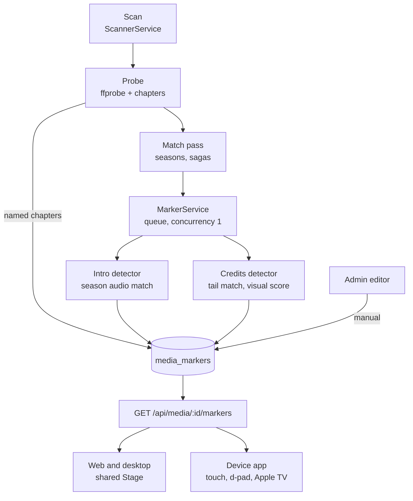
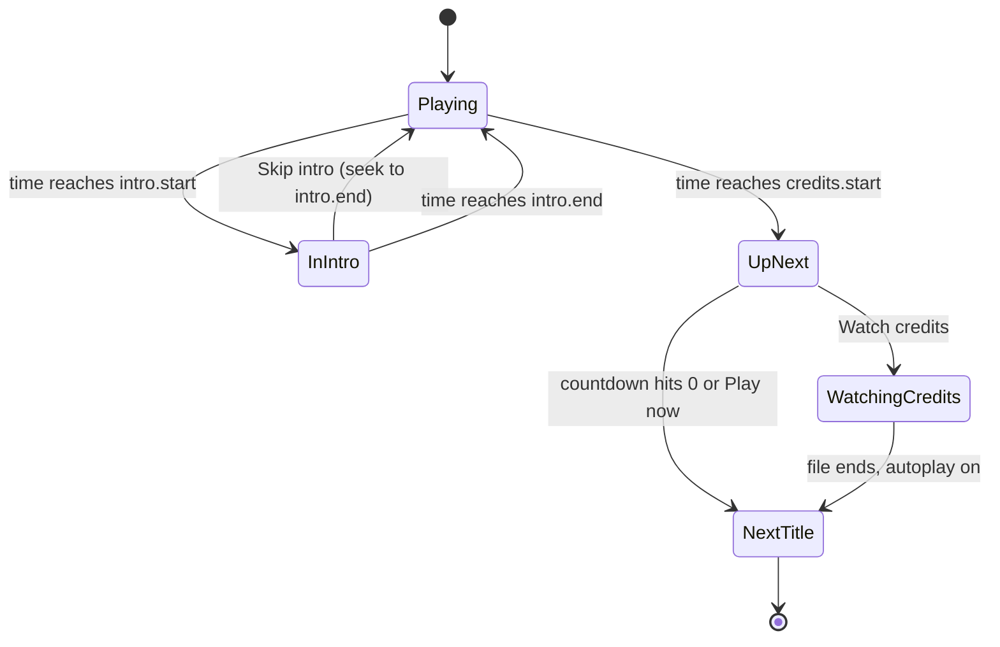
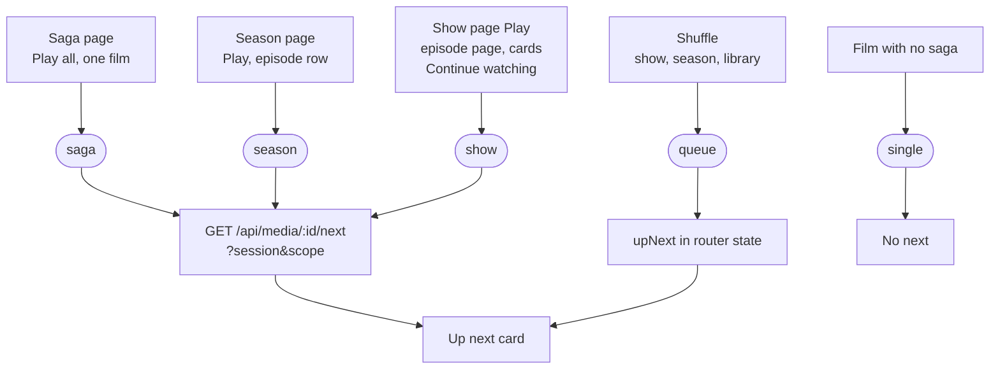
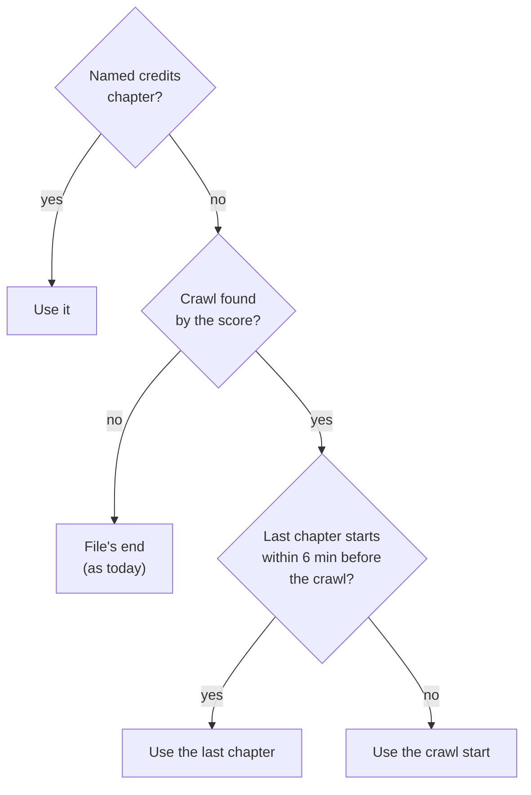
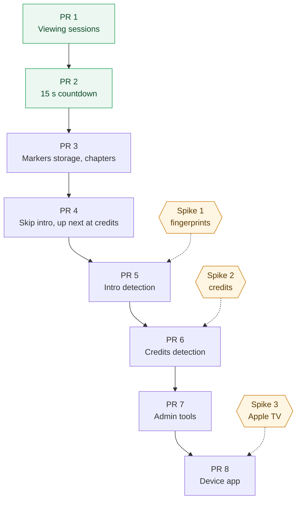

# raven's intro and credits: skip the intro, roll on at the credits

Date: 2026-10-27. Status: approved on 2026-10-28, review points and spike
verdicts as written. Written from research on how Plex, Jellyfin and Emby do
it and a survey of raven's scanner and player. The three spikes ran on
2026-10-28; their findings and verdicts are under Research findings, and
they change the chapter patterns, the head window and how films find their
credits.

## Why

Watching a season in raven today means sitting through every intro and
reaching for the remote at every end. Three gaps:

- **Nothing knows where an intro or the credits are.** There is no table, no
  detector, no API and no UI for it. ffprobe never runs `-show_chapters`, the
  HLS and stream args strip chapters (`-map_chapters -1` in
  `ffmpeg/hlsArgs.ts` and `ffmpeg/args.ts`), and mpv watches no chapter
  property. The shared `Scrubber` can already draw chapter gaps, but no host
  passes it `chapters`.
- **Episodes never roll on.** Up next exists, but only for queues handed over
  in router state: saga Play all, a single film of a saga, and Shuffle.
  Playing an episode from the show, season or episode page, from a card or
  from Continue watching sends no `upNext`, so a TV episode ends and stops.
- **The countdown is tied to the file's end.** `useUpNext` counts down
  `AUTOPLAY_COUNTDOWN_SECONDS = 10` before the last frame, so the viewer
  watches the whole crawl (often 5 to 10 minutes on a film) before anything
  happens. The device app has no up next at all: `onEnd` pauses.

What the rest of the field does, and what raven takes from it:

- **Plex** finds intros by matching shared audio across the episodes of a
  season, and only for intros of 20 seconds or more. Credits are a separate
  machine learning model over text detection, black frames and "a few other
  secret ingredients", which also finds mid and post credits scenes. Markers
  cannot be edited, and forum threads from late 2025 report credits
  detection silently stopping on new content and the Skip Credits button
  appearing too early.
- **Jellyfin's Intro Skipper** plugin (`intro-skipper/intro-skipper`, 2.9K
  stars) fingerprints audio with Chromaprint through ffmpeg, refines each
  boundary to nearby silence or a black frame, and trusts named chapters
  first. Its defaults: intros are searched for in the first 25% of an episode
  or the first 10 minutes, whichever is smaller, and run 15 s to 2 min;
  credits run 15 s to 5 min; movie credits get a 900 s window.
- **Jellyfin's Media Segments** (10.10+) store typed segments (Intro, Outro,
  Recap, Preview, Commercial) that providers write and clients only read.
  Client support is uneven because each client has to draw the button.

The lessons: intros and credits are two problems with two detectors; chapter
names in the file beat any guess; the server owns detection and every client
only reads markers; and markers must be visible and correctable, because no
detector is right every time.

## Goals

1. **Skip intro.** While playback is inside a detected intro, a Skip intro
   button shows; pressing it seeks to the intro's end. An opt-in preference
   skips it without asking.
2. **Up next at the credits.** When playback reaches the credits, an Up next
   card shows the next title of the viewing session with a countdown,
   **15 seconds by default**, that plays it when it runs out. Watch credits
   dismisses the card for this title.
3. **Viewing sessions everywhere.** Next means the next title of what the
   viewer chose to watch: the rest of a saga, the rest of a season, the rest
   of the show (binge), or the shuffled queue. A movie on its own has no
   next.
4. **Server side detection** that runs in the background after a scan,
   survives restarts through database state, and never blocks playback.
5. **Markers an admin can see and fix**: detection status per show and film,
   a Re-analyze action, and a marker editor that wins over every detector.
6. **Every client**: web, desktop (mpv) and the device app (touch, Android TV
   d-pad, Apple TV).

Non-goals: recap, preview and commercial segments (the schema leaves room;
the detectors do not look); a crowd sourced timestamp service such as
TheIntroDB (it sends what the viewer owns to a third party); chapter images.

Anti-goal: a marker that is wrong is worse than none. A Skip intro that jumps
into the cold open, or an Up next that cuts off the last scene, costs more
trust than the feature earns. Every detector returns nothing when it is not
confident.

> [!CAUTION]
> Every detector must return no marker below its confidence floor. An early
> credits marker cuts off the end of a film; that is the failure to design
> against.

## Design

The whole flow, from a file landing in a library to the viewer's next title:



The viewer's side of one title:



### Vocabulary

```ts
export const MARKER_KINDS = { intro: 'intro', credits: 'credits' } as const
export type MarkerKind = (typeof MARKER_KINDS)[keyof typeof MARKER_KINDS]

/** Where a marker came from, strongest first. */
export const MARKER_SOURCES = {
  manual: 'manual',
  chapter: 'chapter',
  fingerprint: 'fingerprint',
  visual: 'visual',
} as const
export type MarkerSource = (typeof MARKER_SOURCES)[keyof typeof MARKER_SOURCES]

export const MARKER_STATES = {
  pending: 'pending',
  done: 'done',
  failed: 'failed',
  skipped: 'skipped',
} as const
```

A marker is `{ kind, start, end, source, confidence }`, in seconds on the
file's own clock (the same clock `mediaClockOf` reads), so HLS, direct play
and mpv all seek to it without translation. One marker per kind per file;
a stronger source replaces a weaker one, and `manual` is never overwritten.


> [!TIP]
> Decision taken from the research: chapter names are trusted above any
> detector (Intro Skipper does the same), and manual edits win over
> everything, which fixes Plex's most common complaint.

### Server

**Schema** (appended to `MIGRATIONS` in `db/database.ts`):

```sql
CREATE TABLE media_markers (
  media_id    INTEGER NOT NULL REFERENCES media(id) ON DELETE CASCADE,
  kind        TEXT    NOT NULL,
  start       REAL    NOT NULL,
  end         REAL    NOT NULL,
  source      TEXT    NOT NULL,
  confidence  REAL    NOT NULL,
  detected_at INTEGER NOT NULL,
  PRIMARY KEY (media_id, kind)
) WITHOUT ROWID;

CREATE TABLE media_fingerprints (
  media_id INTEGER NOT NULL REFERENCES media(id) ON DELETE CASCADE,
  region   TEXT    NOT NULL,   -- 'head' or 'tail'
  version  INTEGER NOT NULL,
  data     BLOB    NOT NULL,   -- packed uint32 fingerprint frames
  PRIMARY KEY (media_id, region)
) WITHOUT ROWID;

ALTER TABLE media ADD COLUMN chapters TEXT;             -- JSON [{ start, end, title }]
ALTER TABLE media ADD COLUMN markers TEXT NOT NULL DEFAULT 'pending';
ALTER TABLE media ADD COLUMN markers_version INTEGER NOT NULL DEFAULT 0;
```

- `media_markers` is not per viewer, so it carries no `account_id`.
- `media_fingerprints` caches the decoded head and tail fingerprints, so a
  new episode in a season compares against its neighbours without decoding
  them again. On a NAS share that saves gigabytes of reads per episode (see
  spike 1).
- `MediaIndex.markChanged` also resets `chapters = NULL`, `markers =
  'pending'`, and deletes the file's non-manual markers and its fingerprints.
  A manual marker on a replaced file is kept but flagged stale in the editor.
- `markers_version` against a `MARKER_DETECTOR_VERSION` constant reruns
  detection when the algorithm improves, the same idea the probe-expansion
  plan has for `probe_version`.

**Chapters.** `probeJson` adds `-show_chapters`. A new `parseChapters` in
`ffmpeg/chapters.ts` keeps `{ start, end, title }` and `saveProbe` writes them
to `media.chapters`. Named chapters become markers with source `chapter` and
confidence 1 when the title matches one of:

```ts
export const CHAPTER_PATTERNS = {
  intro: /^(intro|opening|op|opening credits|title sequence|main titles?)$/i,
  credits: /^(credits|end credits|cast and end credits|ending|ed|closing credits|outro)$/i,
} as const
```

(Spike 1's sample settled these: anime Blu-ray remuxes name `Opening`,
`Ending` and `Preview`; films name scenes and end on `End Credits`,
`Credits` or `Cast and End Credits`. Numbered (`Chapter 02`) and timestamp
(`01:34:18.277`) titles are not names and never match.) Chapters also go to the player's `Scrubber`,
which already draws them.

**`MarkerService`** (`markers/markerService.ts`), on the scanner's pattern:

- A `createTaskQueue({ concurrency: 1 })` keyed `season:<id>` for episodes
  and `media:<id>` for films, so a season is analyzed as one job and keys are
  de-duplicated while a scan is still adding episodes.
- Enqueued by `MetadataService` once a match pass has placed episodes into
  seasons (detection needs the season grouping), and by the scanner's
  `probe()` for films.
- `onApplicationBootstrap` re-enqueues every `markers = 'pending'` row, the
  way `ThumbnailService.retryPending` does. Nothing else persists the queue.
- Runs ffmpeg through `FfmpegService` with a new `markerTimeoutSeconds` and
  under `nice`, at concurrency 1, and yields to playback: a job waits while
  an HLS session is transcoding (`hlsSessions`), so detection never starves a
  viewer.
- Config: `MARKER_DETECTION` (`on`, `off`, default `on`) and
  `MARKER_CONCURRENCY` (1). An admin setting `detectMarkers` in the
  `playback` settings key turns it off per server without a restart.

> [!IMPORTANT]
> Detection waits while any HLS session is transcoding, so on a busy
> evening a new season may wait hours for markers. The alternative is to run
> beside playback at a lower priority and accept some contention on
> Vhagar's Celeron.

**Intro detection** (`markers/introDetector.ts`), per season:

1. For each episode without a cached head fingerprint, decode the audio of
   the first `min(25% of duration, 10 min)` to mono 11025 Hz and fingerprint
   it with ffmpeg's `chromaprint` muxer (`-fp_format raw`, spike 1),
   storing it in `media_fingerprints`. An episode left without a match
   while its season mates matched gets a second pass over
   `min(33% of duration, 15 min)` (Severance's intro starts 26% in).
2. Pair each episode with its neighbours (previous and next by episode
   number, plus one at random so a single odd episode does not break the
   chain). For each pair, find the longest aligned run where the Hamming
   distance between fingerprint frames stays under a threshold, allowing a
   different offset in each file (cold opens move the intro).
3. Keep runs of 15 s to 2 min. An episode's intro is the run it shares with
   the most partners; confidence is the share of partners that agree within
   2 s. Below `MIN_INTRO_CONFIDENCE`, no marker.
4. Refine both ends: snap to a chapter start within 10 s if the file has
   one, else to the nearest shot change within 8 s (`select='gt(scene,0.3)'`
   over just those seconds), so the skip lands on a clean cut. Spike 1 found
   music that bleeds across the cut, and anime title cards that share the
   opening's last sting, put raw boundaries 4 to 7 s off.
5. A season of one episode, or specials with no partners, gets no
   fingerprint marker, only chapter markers if it has them.

**Credits detection** (`markers/creditsDetector.ts`), two paths:

- **Episodes**: the same fingerprint match over the last
  `min(20% of duration, 6 min)` (`tail` region), since many shows reuse an
  end theme (14 of 39 sample episodes). Where it finds nothing, the episode
  rolls on at the file's end, as today.
- **Films**: a named credits chapter first. Without one, the crawl score
  (spike 2): the last 15 minutes, keyframes only (`-skip_frame nokey`), one
  frame a second at 320 px, a frame counting as crawl when its mean
  saturation is 3 or less and 60% or more of it is dark. The credits start
  at the crawl's start at the latest: the score is late on films whose
  credits open with title cards, photos or art, never early. An unnamed
  last chapter does not move it (it was 67 s early on Deadpool). Picture
  after the crawl marks a post credits scene (`end` < duration). Detecting
  the true start before the crawl waits for a text detection spike.
- A credits marker always ends at or before the file's end; `end` well
  before the duration means content follows.

**Routes** (guards per `apps/raven/CLAUDE.md`):

| Route | Guard | What |
| --- | --- | --- |
| `GET /api/media/:id/markers` | approved | `{ intro, credits, chapters }`, each nullable |
| `PUT /api/media/:id/markers` | `@AdminOnly()` | Save manual markers (or clear one back to detected) |
| `POST /api/items/:id/markers/analyze` | `@AdminOnly()` | Re-analyze a film, season or show now |
| `GET /api/libraries/:id/markers` | `@AdminOnly()` | Status counts: pending, done, failed, with and without markers |

`GET /api/media/:id/markers` joins `APP_CLIENT_CALLS` so the device app can
call it, and desktop main's allowlist only if main ever needs it (the
renderer calls the server as the web app does). Markers stay out of
`isMediaItem`, which lists carry by the hundred; the player fetches them per
title, the way it fetches tracks. A new SSE event is not needed: the player
fetches markers on load, and a title analyzed mid-watch picks them up next
time.

> [!IMPORTANT]
> Markers are a separate request per title rather than a field on
> `MediaItem`. That costs one extra call when playback starts but keeps every
> list response the same size.

**Viewing sessions.** Next is resolved by the server from a small session
description instead of a long queue in router state, so a binge across
seasons survives link to link without carrying every episode:

```ts
export const SESSION_KINDS = {
  single: 'single',
  season: 'season',
  show: 'show',
  saga: 'saga',
  queue: 'queue',
} as const
```

| Kind | Started from | Next is | Ends |
| --- | --- | --- | --- |
| `single` | a film with no saga, Play on a library item | nothing | at the end |
| `season` | Play or an episode row on a season page | next episode of that season | after its last episode |
| `show` | show page Play, episode page, card, Continue watching | next episode in show order, across seasons, specials last | after the last episode |
| `saga` | saga Play all, a film of a saga | next film of the saga | after the last film |
| `queue` | Shuffle (show, season, library) | next of the shuffled queue it already carries | after the queue |

- `GET /api/media/:id/next?session=<kind>&scope=<sagaId>` returns the next
  `MediaItem` or null, from the playing file's own library, using
  `mediaRepository`'s existing episode order (`season_number = 0` last,
  then season and episode, best file first). Only `saga` needs `scope`:
  the playing episode names its own season and show. `queue` keeps today's
  `upNext` list in router state; it is already bounded by `SHUFFLE_LENGTH`.
- `isWatchState` gains `session` (a discriminated union on `kind`) in place
  of `isShuffled`, and `watchLink` takes it. `upNext` stays for `queue`
  only. A link that names no session gets `sessionOf(media)`: `show` for an
  episode, `single` for anything else, which is also what a refresh or a
  direct visit plays in. So the show page, episode page, cards and Continue
  watching need no change; the season page passes `season`, the saga page
  `saga`, and Shuffle `queue`.
- The end of a `season` session offers Next season without a countdown,
  since the viewer chose one season.



> [!IMPORTANT]
> A `season` session stops at the season's end, while `show` rolls
> into the next season. That reads your request as two different modes. If
> you would rather Play on a season page also binge on, `season` collapses
> into `show`.

### Contract (`libs/raven/core`)

- `contract/markers.ts`: `MARKER_KINDS`, `MARKER_SOURCES`, `isMarker`,
  `isMediaMarkers` (`{ intro, credits, chapters }`), `isMarkerEdit` for the
  PUT body, `isMarkerStatus` for the library counts.
- `contract/sessions.ts`: `SESSION_KINDS` and `isViewingSession`.
- `itemLinks.ts`: `session` in `isWatchState`, `watchLink`, `readWatchState`.
- `apiClient/media.ts`: `getMarkers`, `saveMarkers`; `apiClient/items.ts`:
  `analyzeMarkers`, `nextInSession`.
- `mediaProgress.ts`: `resumeAtFor` treats a saved position at or past the
  credits start like one within `RESUME_MARGIN_S` of the end: start over.

### Watched

Reaching the credits start counts as watching the title: the player records
the play there, even when that is short of the library's
`watched_percent` (a two hour film with ten minutes of credits ends at 92%).
Without a credits marker, today's percentage rule stands. This keeps Continue
watching from offering the last ten minutes of credits back.

> [!IMPORTANT]
> This changes the watched rule from the 2026-10-15 watched spec. A
> wrong, early credits marker would now mark a film watched before its end.

### Player (`libs/raven/ui`)

- **`PlayerTitle`** gains `markers: MediaMarkers | null`, filled by each host
  from `getMarkers`, and `next` is resolved from the session.
- **`useSkipIntro`** (new, headless): returns `{ intro, isInside, skip }`
  from `time` and the marker. With `autoSkipIntro` on, it seeks to the end
  once per title the first time playback enters the intro, and shows an
  Undo for a few seconds.
- **`useUpNext`**: the countdown starts at
  `min(credits.start, duration - countdownSeconds)` instead of always
  `duration - AUTOPLAY_COUNTDOWN_SECONDS`, and runs for the viewer's
  `autoplayCountdownSeconds` (default 15) rather than to the file's end. At
  zero it records the play and navigates. With no credits marker, the
  countdown runs over the last `autoplayCountdownSeconds` of the file, as
  today but 15 s. `AUTOPLAY_COUNTDOWN_SECONDS` becomes the preference's
  default.
- **`UpNextCard`** (new component, SCSS module): poster, title, "Season 2,
  Episode 4" or the saga position, the countdown ring the `NextButton`
  already draws, and two buttons, Play now and Watch credits. When the
  credits marker ends before the file does, it adds "A scene follows the
  credits". It sits in its own grid area of the stage so it never covers the
  controls, takes focus on TVs, and its appearance is guarded by
  `prefers-reduced-motion`.
- **`SkipButton`** (new): one control used for Skip intro (and, when the up
  next card was dismissed, Skip credits to the end of the credits). Bottom
  right, focusable, `--focus-ring`, labelled for screen readers.
- **`Stage`** passes `chapters` to `Controls` at last, and keeps the chrome
  shown while the card is up, as the countdown already does.
- **`playerPrefs`**: `autoplayCountdownSeconds` (5 to 60, default 15) and
  `autoSkipIntro` (default false), both in `partialize`.

> [!IMPORTANT]
> The countdown and auto skip are per device preferences, like
> today's autoplay toggle, not per account. A viewer sets them once on each
> TV, phone and browser.

### Web (`apps/raven/web`)

- Every entry point in the sessions table passes its session.
- **Settings**: the Browser playback subsection gains Autoplay (today only in
  the player menu), the countdown slider and Skip intros automatically.
  The server Playback section gains Detect intros and credits (admin).
- **Item pages, for admins**: a Markers panel on episode and movie pages
  shows each marker with its source and confidence, lets an admin set start
  and end from the current player position or by typing a time, and offers
  Re-analyze. Show and season pages show how many episodes have markers.
- **Libraries page**: a line per library with detection progress from
  `GET /api/libraries/:id/markers`.

### Desktop (`apps/raven/desktop`, `libs/raven/mpv`)

The desktop plays through the shared `Stage` on the native engine, so skip
and up next come for free once the engine's `seek` lands accurately. Two
checks: mpv seeks to a marker with `absolute` (exact, not keyframe) so the
skip does not land a few seconds early; and `onEndFile`'s `EOF_SHORT_S` rule
must not report a navigation at the credits as a decode error, since the
player leaves well before the end on purpose.

### Device app (`apps/raven/app`)

The app has its own chrome per platform and no up next, so it is built
separately, on the same headless hooks:

- `useSkipIntro` and a headless `useUpNext` move into `@raven/ui/headless`
  (today `useUpNext` imports `react-router-dom`; navigation becomes a
  callback the host supplies).
- **Touch and Android TV (d-pad)**: Skip intro and the Up next card in
  `PlayerChrome.touch.tsx` and `PlayerChrome.dpad.tsx`, the card taking
  focus when it appears.
- **Apple TV**: `PlayerChrome.focus.tsx` uses the system transport, which
  raven draws nothing over. tvOS has native "contextual actions" for exactly
  this (the Skip intro pill on Apple TV+). Whether react-native-video 6.19.3
  exposes them, or a small Expo module has to, is spike 3.
- `appPrefs` gains the same two preferences.

## Spikes

Each spike is a time boxed branch that ends in a short findings note
appended to this spec and a go or no-go, not shipped code. They run against
a labelled sample from Vhagar's libraries.

**The sample.** 12 shows, 3 episodes each, chosen for variety: a network
drama with a cold open, an anime with named OP and ED chapters, a sitcom
with a 10 second title card, a prestige show whose intro changes per season,
a show with no intro, a reality show; plus 12 films: Marvel (mid and post
credits scenes), animation, a foreign film, an old film with short opening
credits only, a film whose credits play over footage. Each title is
hand-labelled with intro and credits start and end to the second, kept in a
fixture file for the detector tests that follow.

> [!WARNING]
> The Homebrew ffmpeg on dev Macs has no `chromaprint` muxer (checked while
> writing this spec), and reading the first 10 minutes of a 4K remux over SMB
> can be several gigabytes. Spike 1 settles both before any detector code.

**Spike 1: audio fingerprints and intros** (3 days)

- Toolchain: does Debian's `ffmpeg` in the image have the `chromaprint`
  muxer (`ffmpeg -muxers | grep chromaprint`)? The Homebrew ffmpeg on dev
  Macs does not. Options, in order of preference: ffmpeg's muxer with
  `-fp_format raw`; `fpcalc -raw` from Debian's `libchromaprint-tools` (one more
  package in the Dockerfile's `apt-get install`); a
  fingerprint computed in TypeScript from PCM that ffmpeg decodes
  (`-f s16le -ac 1 -ar 11025`), which needs no native dependency on any
  platform. Pick the one that works in the image and on a dev Mac.
- Matching: implement the aligned run search, measure on the sample. Go if
  intro boundaries land within 2 s of the label on at least 85% of episodes
  that have a shared intro, with markers on no more than 1 in 20 episodes
  that have none.
- Cost: wall time and bytes read per episode over the SMB shares, with and
  without the fingerprint cache, for a 1080p web file and a 4K remux. If the
  head window of a remux reads gigabytes, decide whether to shrink the window
  or read audio only through a demuxer that skips video packets.
- Chapters: how many sample files carry named chapters, and what the names
  are, to settle `CHAPTER_PATTERNS`.

**Spike 2: credits** (3 days)

- Tail fingerprints for episodes: how often does a shared end theme find the
  credits?
- The visual score for films: implement it with ffmpeg filters only and
  measure. Go if the credits start lands within 10 s of the label on at
  least 80% of films and 5 s on episodes, never more than 30 s early (early
  cuts off the film; late only costs a few seconds of crawl).
- If the score falls short, measure the next step up before going further:
  text detection on sampled frames (Tesseract or an ONNX text detector
  running in the server), and its cost per film on Vhagar's Celeron. Plex
  needs text detection; raven may not if the sample says otherwise.
- Post credits scenes: can the score find the return to normal picture?

**Spike 3: Apple TV** (1 day)

- Can the app show a Skip intro action and an up next prompt over the system
  transport (`AVPlayerViewController.contextualActions`, or
  `transportBarCustomMenuItems`) through react-native-video, a patch, or a
  small Expo module? If not, the fallback is raven's own overlay on Apple TV
  only while a marker is active.

## Research findings

The three spikes ran on 2026-10-28, on Vhagar itself: inside the running
raven container (Debian's ffmpeg 5.1.9, node 24, the Celeron J4125), over
the same `/media/<nas>` mounts the server reads. The sample is 13 shows of 3
episodes (Season 2 episodes 2 to 4, or the nearest season) and 11 films;
Crouching Tiger left the library mid spike, so 50 files in all. Every title,
its hand label, the detection and its cost is in
[`2026-10-27-raven-intro-and-credits-labels.json`](2026-10-27-raven-intro-and-credits-labels.json),
the fixture the detector tests and the accuracy script start from.

**How the labels were made.** Where a file has a chapter that names or
bounds the segment (Frieren's `Opening` and `Ending`, the films' `End
Credits`, Attack on Titan's and Game of Thrones' numbered chapters at the
intro's end), the chapter is the label. Everywhere else the label comes
from contact sheets cut on Vhagar: one frame a second for 4 s either side of
each detected boundary, and for films the last 15 minutes at one frame every
15 s, refined by eye. An intro starts on its first frame and ends on the
first frame after its last picture; the credits start where the story's
last shot ends.

> [!NOTE]
> Vhagar's 5 minute `update.sh` recreated the raven container mid run (a
> new image landed at 23:52) and took `/tmp` with it. The spike's working
> files moved to `/config/spike` and were deleted afterwards. Anything
> long running inside the container, the analysis queue included, must
> survive a recreate: it is why fingerprints live in the database.

### Spike 1: audio fingerprints and intros

**Toolchain: go.** Debian's ffmpeg in the image has the `chromaprint` muxer
(`E chromaprint`), so `ffmpeg -map 0:a:0 -ac 1 -f chromaprint -fp_format raw
-` is all the server needs: no `fpcalc`, no extra package, no fingerprint
code in TypeScript. Only the Homebrew ffmpeg on dev Macs lacks it, so
fingerprint tests run on stored fixtures and the accuracy script runs on
Vhagar. A fingerprint is one 32 bit point per 0.1238 s, about 30 KB per
episode for the head and tail together.

**Matching.** The aligned run search (an inverted index for candidate
shifts, then points within 6 differing bits, gaps up to 3.5 s, runs of 15 s
to 130 s) found an intro in every show that has one, at every offset the
sample has: Game of Thrones at 0 s, Brooklyn Nine-Nine after a 43 s cold
open, Better Call Saul after 6 minutes.

| Show | Episodes within 2 s at both ends | Why the others missed |
| --- | --- | --- |
| Buffy the Vampire Slayer | 3 of 3 | |
| Stranger Things (1080p remux) | 3 of 3 | |
| Brooklyn Nine-Nine | 3 of 3 | |
| Better Call Saul (4K) | 3 of 3 | |
| Game of Thrones (4K remux) | 3 of 3 | |
| Friends | 2 of 3 | "The One with the Cake" runs its credits over new footage; the end is 4 s or more early |
| Hell's Kitchen | 2 of 3 | end 3 s early on one episode |
| Succession | 1 of 3 | the theme's first bars play under the cold open's last shot: the start is 7 s early on two |
| Frieren | 1 of 3 | the opening's music runs 6 s into the episode's first shot: the end is 6 s late on two |
| Attack on Titan | 0 of 3 | the episode title card shares the opening's closing sting: the end is 4 to 5 s late, on the first scene |
| Severance | 0 of 3 | S02E02's intro starts at 719 s, 26% in, outside the window; with no partner the others fail too |
| Barry, The Bear (no intro) | 0 false markers in 6 | |

As measured that is **21 of 33 episodes (64%)** within 2 s, against a bar
of 85%, and **0 of 6** episodes without an intro given a marker, inside the
bar of 1 in 20. Every miss falls in one of three classes, each with a fix
that costs almost nothing:

1. **A chapter boundary nearby** (Frieren, Attack on Titan, and Game of
   Thrones' already exact ends): snap a detected boundary to a chapter
   start within 10 s. 5 of the 12 misses.
2. **Music that bleeds across a cut** (Succession's start, Hell's
   Kitchen's end): snap to the nearest shot change within 8 s, found with
   ffmpeg's `select='gt(scene,0.3)'` over just those seconds, a decode of
   under 20 s of video. 3 of the 12.
3. **The window** (Severance): search `min(33%, 15 min)` instead of
   `min(25%, 10 min)`, and widen it only for an episode the first pass left
   without a match while its season mates matched. 3 of the 12. A longer
   25 minute run found S02E02's and S02E03's intros (79 s, at 719 s and
   189 s) but still nothing in S02E04, so the wider window is necessary,
   not sufficient, for a show like it.

Friends' special episode stays a miss; that is what Edit markers is for.

> [!IMPORTANT]
> Spike 1 is a **go with conditions**: PR 5 ships the chapter snap, the
> shot change snap and the wider second pass, and its accuracy script must
> show 85% on this fixture before it merges. Without them the detector is
> at 64%. Yes or no?

**Cost.** ffmpeg demuxes video packets interleaved with the audio, so
bytes read are about bitrate times window whatever stream is mapped; there
is no audio only read of a Matroska file. Medians from the run:

| File | Bitrate | Head (10 min) read | Head wall time |
| --- | --- | --- | --- |
| 1080p web episode | 1 to 14 Mb/s | 0.1 to 0.9 GB | 3 to 36 s |
| 1080p Blu-ray remux | 34 to 38 Mb/s | 1.5 to 2.7 GB | 28 to 130 s |
| 4K web episode | 23 to 26 Mb/s | 1.6 GB | 32 s |
| 4K Blu-ray remux | 68 Mb/s | 4.9 to 5.3 GB | 92 to 110 s |

Wall times are ranges because the container was recreated mid run, and the
new server's library scan shared the Celeron and the disks with the second
pass (Stranger Things' heads took 28 s in the first pass and 76 to 132 s
in the second). The fingerprint cache makes the cost one time: once stored,
a new episode is compared against its season in milliseconds.

> [!TIP]
> Decided: keep the window by time, not bytes, and accept remux cost as a
> one time price per episode. A 4K remux season of 10 episodes reads about
> 50 GB once, around 20 minutes on Vhagar's disks; the queue's yield to
> HLS sessions keeps it off the critical path.

**Chapters.** 21 of the 50 files carry chapters, but only Frieren's names
segments of an episode (`Opening`, `Part A`, `Part B`, `Ending`,
`Preview`). Blu-ray episodes have numbered chapters (`Chapter 02`), which
sit on intro boundaries often enough to be the snap targets above but say
nothing alone. Films have named scenes (Iron Man, Up, Citizen Kane,
Anchorman) or timestamps (Toy Story 3, Guardians Vol. 2). `CHAPTER_PATTERNS`
above is updated from this census.

### Spike 2: credits

**Episodes: the end theme works where there is one.** Tail fingerprints
found a shared end theme on 14 of 39 episodes: Buffy, Better Call Saul,
Frieren, Attack on Titan (all 3) and Succession (2 of 3). The 6 with an
`Ending` or numbered chapter to check against land within 2 s. Shows that
play songs or new score over their credits (Stranger Things, Game of
Thrones, Severance) or roll credits over the last scene (Friends, Brooklyn
Nine-Nine) have no shared theme to find, so they fall back to the file's
end, as raven does today.

**Films: the visual score alone is a no-go.** The ffmpeg only score
(keyframes only, one frame a second, `signalstats`, `blackframe`,
`entropy`) looks for the crawl: frames with mean saturation 3 or less and
60% or more of pixels dark. It finds the crawl reliably, and it is never
early, but credits rarely start with the crawl:

| Film | Credits start (label) | Score | Last chapter |
| --- | --- | --- | --- |
| Knives Out (4K) | 7520 | 7518 (2 s early) | none |
| Anchorman | 5560 | 5560 | `End Credits` 5560 |
| Iron Man (4K) | 7058 | 7088 (30 s late, title cards) | `End Credits` 7058 |
| Deadpool | 6060 | 6156 (96 s late, red title cards) | `Chapter 28` 5993 (67 s early) |
| The Hangover (4K) | 5510 | 5636 (126 s late, photos) | none |
| Ant-Man | 6450 | 6620 (170 s late, title cards) | `Chapter 16` 6454 |
| Toy Story 3 | 5656 | 5923 (267 s late, art beside the text) | `01:34:18.277` 5658 |
| Up | 5342 | none (illustrated cards) | `Credits` 5342 |
| Guardians of the Galaxy Vol. 2 | 7633 | none (coloured crawl) | `02:07:13.459` 7633 |
| Oldboy (4K) | 7060 | none (crawl over a mountain) | `Chapter 15` 6567 (8 min early) |
| Citizen Kane | 7032 | black and white, score unusable | `Cast and End Credits` 7032 |

That is **2 of 11 within 10 s**, against a bar of 80%. Never early, so the
safety rule holds: a late start only shows the countdown later.

What does work for films:

- **A named credits chapter**: 4 of 4 exact (Iron Man, Up, Citizen Kane,
  Anchorman). Already first in the precedence.
- **An unnamed last chapter**: on the credits in 3 of 5 (Toy Story 3, Ant
  Man, Guardians Vol. 2), but 67 s and 8 minutes early on the other two.
  Too often early to trust alone; good as a candidate the score confirms.
- **The crawl** as a floor: where the score finds one, the credits have
  started by then.

The spike tried combining them, using the last chapter when it starts
within 6 minutes before the crawl:



On the sample that rule gives Iron Man, Up, Citizen Kane, Anchorman, Toy
Story 3 and Ant-Man exactly, Knives Out at 2 s, and Deadpool 67 s early
(its last chapter is 163 s before the crawl), with The Hangover late and
Guardians Vol. 2 and Oldboy at the file's end: 7 of 11, still short of the
bar, and Deadpool's early cut is the kind the spec forbids. So the design
above keeps named chapters and the crawl floor, and drops the last chapter
rule.

> [!WARNING]
> Not measured: text detection, the step the spec names when the score
> falls short. The raven container runs as an unprivileged user with no
> Tesseract or ONNX runtime, and installing one is an image change, not a
> spike. Its cost on the Celeron is still the open question for films.

> [!IMPORTANT]
> Spike 2 is a **no-go for detected film credits** and a **go for
> episodes**. PR 6 ships the end theme for episodes and, for films, only
> named credits chapters plus the crawl floor (credits by the crawl's start
> at the latest, so up next shows late, never early). Detected film credits
> wait for a follow up spike on text detection, with its own image change.
> Yes or no?

**Post credits scenes.** After the crawl the score sees normal picture
again: it found Iron Man's (7539 s) and Deadpool's (6454 s) scenes, missed
Ant-Man's two (the mid credits scene plays before the crawl the score
starts from, and the post credits scene is dark and nearly colourless, so
it reads as crawl), and
flagged Anchorman's bloopers, which play beside the credits. Good enough to
offer Watch credits, not to skip to a scene.

**Cost.** The tail picture pass reads the same bytes as the tail
fingerprint (about bitrate times 15 minutes, 1 to 5.5 GB) and took 16 to
75 s, 4K HEVC included, because `-skip_frame nokey` decodes keyframes only.
Run it in the same ffmpeg invocation as the tail fingerprint and the film
pays one read.

### Spike 3: Apple TV

**Go, by a patch.** The Apple TV player is `react-native-video` 6.19.3 with
`controls`, which is `AVPlayerViewController` and the system transport.
The library already turns its `chapters` prop into the transport bar's
navigation markers on tvOS (`RCTVideoTVUtils.makeNavigationMarkerGroups`),
so markers can show on the Apple TV scrubber with no native work. It does
not expose `contextualActions`, the tvOS 15 API that puts a button such as
Skip Intro over the transport. A Swift probe that sets
`contextualActions` and `transportBarCustomMenuItems` on an
`AVPlayerViewController` type checks against the AppleTVOS 27 SDK for
`arm64-apple-tvos15.1-simulator` and fails below tvOS 15, as documented.

The patch (`bun patch react-native-video`) adds a `contextualActions` prop
(id and title) and an `onContextualAction` event: by estimate about 40 lines across
`RCTVideoManager.m`, `RCTVideo.swift` and the prop types, setting
`_playerViewController?.contextualActions` whenever the prop changes.
raven's own overlay on Apple TV is not needed. Still to prove in PR 8:
the patched build on a device and focus on the action from the Siri
Remote.

> [!TIP]
> Decided: Apple TV gets Skip Intro and the up next prompt as contextual
> actions through a `bun patch` of react-native-video, and its chapters
> through the `chapters` prop it already has.

## Testing

- **Server (vitest)**: `parseChapters` and the chapter patterns; the aligned
  run search on synthetic fingerprints (shared run at different offsets,
  no shared run, two candidate runs); the credits score on fixture frame
  statistics; `MarkerService` enqueue, de-duplication, bootstrap retry and
  yielding to an HLS session; precedence (manual over chapter over
  detected); `markChanged` clearing; the routes' guards and the
  `APP_CLIENT_CALLS` and account tests the repo already enforces; `next` for
  each session kind, including across seasons and specials last.
- **Detector accuracy**: the spike sample's labels become a fixture, and a
  script (`scripts`, TypeScript) scores the detectors against the real files
  on demand. It does not run in `verify` (it needs the media), but its last
  result is recorded in the PR that changes a detector.
- **Core**: guards for markers and sessions; `resumeAtFor` with a credits
  marker.
- **UI (bun test + happy-dom)**: `useSkipIntro` (inside, outside, auto skip
  once, undo); `useUpNext` starting at the credits, running the configured
  seconds, Watch credits, falling back to the file's end; `UpNextCard` and
  `SkipButton` rendering and focus.
- **App (jest-expo)**: the touch and d-pad chrome with a marker and an up
  next title, in `test:screens`.
- **Desktop e2e (Playwright)**: skip intro on a fixture file with an intro
  chapter lands on its end.

## Order of work

Stacked PRs, each one commit, 10 to 50 files, each useful on its own. The
first two ship value before any detector exists.

1. **Viewing sessions.** `SESSION_KINDS`, `isWatchState.session`,
   `GET /api/media/:id/next`, every entry point passing its session, saga
   links moved off `upNext`. Episodes now roll on at the end of the file.
2. **The 15 second countdown.** `autoplayCountdownSeconds` (default 15) and
   the Autoplay settings on the Settings page; the `UpNextCard` at the
   file's end, and Next season without a countdown at a `season` session's
   end.
3. **Markers storage and chapters.** Migrations, `-show_chapters`,
   `parseChapters`, chapter markers, `GET /api/media/:id/markers`, the
   contract, chapters on the `Scrubber`. Files with named chapters get skip
   and credits markers here.
4. **Skip intro and up next at the credits** in the shared player, on
   whatever markers exist: `useSkipIntro`, `SkipButton`, the countdown at the
   credits, watched at the credits, `resumeAtFor`.
5. **Intro detection**, after spike 1 (go with conditions): `MarkerService`,
   fingerprints, the cache, the admin setting, the chapter and shot change
   snaps, the second pass; 85% on the spike's fixture before it merges.
6. **Credits detection**, after spike 2: end themes for episodes; named
   chapters and the crawl floor for films.
7. **Admin tools**: the Markers panel, Re-analyze, library status.
8. **Device app**: headless hooks, touch and d-pad chrome, and on Apple TV
   contextual actions through a `bun patch` of react-native-video and
   chapters through its `chapters` prop (spike 3).

Spikes 1 and 2 can run beside PRs 1 to 4; spike 3 beside PR 8's start.



> [!TIP]
> PRs 1 and 2 ship value with no detection at all: episodes roll on from
> every entry point, with a 15 second countdown.

## Out of scope

- Recap, preview and commercial segments (`MARKER_KINDS` can grow).
- Crowd sourced or third party timestamp services.
- Per viewer markers or per viewer skip history beyond the preferences.
- Chapter thumbnails on the scrubber.
- Detecting intros in films (opening credits over footage are too varied;
  chapters still work).
