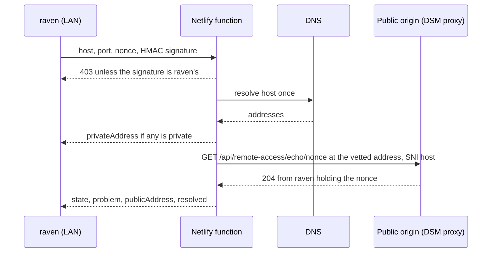

# raven remote access

Date: 2026-11-04. Status: built, on branch `trusted-proxies`; revised 2026-11-05 after a code review (the server alone sizes a remote transcode, the strict tier is counted whole after the account gate, the reachability check is signed and pinned to its vetted address, and the Netlify build reads its API origin from core).

raven reaches the internet through Tailscale Funnel today. Funnel was measured at about 0.58 MB/s (4.7 Mb/s), which makes a 25.7 Mb/s 4K file unwatchable away from home, while the LAN origin carries about 86 Mb/s. This design takes Tailscale out of raven on every device and platform and makes raven reachable the way Plex is: a router port forward to the NAS, a public port the owner names in the Admin page, a status line that says whether raven is "Fully accessible outside your network", an upload speed and a limit on remote stream bitrate.

## What exists today

| Piece | Value on Vhagar (Synology DS, Celeron J4125, LAN `192.168.50.6`) |
| --- | --- |
| raven | Docker, `8484:8484`, bridge network |
| `RAVEN_WEB_URL`, `RAVEN_WEB_ORIGINS` | `https://raven-player.netlify.app` |
| `RAVEN_MEDIA_ORIGINS` | `lan:` a QuickConnect "direct" name for the LAN address (DSM's nginx, Synology's `*.<id>.direct.quickconnect.to` certificate), `public:` the Funnel address |
| Netlify `RAVEN_API_ORIGIN` | the Funnel address, written into `_redirects` at build time |
| Desktop `DEFAULT_SERVER_ORIGIN` | the Funnel address, compiled in |
| Device app and Wren | `https://raven-player.netlify.app`, so their API calls ride Netlify and then the Funnel |
| Root `dev:raven:prod` | the Funnel address |

The media origin kinds are `lan`, `tailnet` and `public`. `tailnet` only ever meant Tailscale.

## Goals

- No Tailscale anywhere: no sidecar, no `ts.net` default, no `tailnet` kind, no doc that tells anyone to use it.
- Away from home, media comes straight from Vhagar at the speed of its upload.
- The owner configures remote access in the Admin page, as Plex's Remote Access settings do, and sees whether it works from outside.
- A remote stream can be held under a bitrate the owner picks, so one remote viewer cannot use the whole upload.
- Every client keeps working through the migration, and none needs the user's IP compiled in.

## Non goals

- Universal Plug and Play or NAT-PMP. Plex opens the port itself when the router allows it; raven asks the owner to forward it, as Plex's "Manually specify public port" does. Asking a router that speaks either to open it is a follow-up.
- A relay for viewers behind a NAT the owner cannot forward through (CGNAT). The status line says so; the fix is the ISP's.
- Moving TLS into raven (see below).

## 1. The public hostname and its certificate

A browser on `https://raven-player.netlify.app` can only fetch media from an https origin with a publicly trusted certificate (mixed content), and Netlify's `_redirects` target for `/api` is fixed when the site builds. So the public address must be a hostname that stays the same when the WAN IP changes, with a certificate that renews itself.

| Option | Stable name | Trusted certificate | Renews itself | Verdict |
| --- | --- | --- | --- | --- |
| **DSM reverse proxy + Synology DDNS (`<name>.synology.me`) + Let's Encrypt from DSM** | Yes: DSM updates the record when the WAN IP changes | Yes | Yes, DSM renews it; for a `synology.me` name Synology answers the challenge itself, so no port 80 is opened | **Chosen** |
| QuickConnect direct name, `<wan-ip-dashed>.<id>.direct.quickconnect.to` | No: the name spells the WAN IP, so it changes with it, and Netlify's `_redirects` would point at the old one until the next build | Yes (Synology's wildcard) | Yes | Rejected for the public origin. It stays fine for `lan:`, whose name spells the reserved LAN address |
| raven terminating TLS itself through ACME | Needs a DDNS name anyway | Yes | Only if raven runs an ACME client, keeps an account key and a private key, and opens port 80 or holds a DNS API token | Rejected: it duplicates what DSM already does, puts key material in raven's data folder, and adds a second TLS stack to patch |

The chosen setup puts nothing new in raven's image. DSM's nginx already terminates TLS for the `lan:` origin, so the public origin is one more reverse proxy rule beside it. The same steps work on any Synology NAS (Meleys, say) with its own DDNS name; another vendor's box needs any reverse proxy with a Let's Encrypt certificate in front of raven's port.

A custom domain works the same way: a CNAME to the `synology.me` name and a certificate for it. Let's Encrypt validates a custom domain over HTTP, so port 80 must reach DSM while it renews, which the `synology.me` name avoids.

## 2. Ports

Two ports, as Plex shows them:

- **The public port** is what the internet connects to on the router's WAN address. The owner forwards it on the router and types it into **Manually specify public port**. raven never guesses it. The design recommends a dedicated high port (any free one, `8443` in the examples below), not 443: the DSM reverse proxy on 443 also answers for DSM's other hostnames, and a dedicated port exposes the raven rule alone.
- **The private port** is the port on the NAS the router forwards to: the port the DSM reverse proxy rule listens on. It is usually the same number as the public port, so the field is optional and blank means "the same as the public port".

raven's own port, `8484`, is never forwarded. Only the reverse proxy faces the internet.

## 3. Public IP discovery

raven asks from outside. Plex's server asks plex.tv what address it came from; raven asks a Netlify function on its own site (section 5), which reads the address the call came from (`context.ip`). That address is the WAN IP of the home network, and the function also resolves the hostname, so the status can say "the hostname points at 203.0.113.4 but your network's address is 203.0.113.9" when DDNS is stale. No third-party IP echo service is involved, and the WAN IP is never stored in code or configuration.

## 4. Advertising the public origin

The owner saves remote access in the Admin page. It is server state, kept in SQLite `settings` under a new key, `remoteAccess`:

```ts
{
  isEnabled: boolean,
  hostname: string | null,      // raven.example.synology.me, a DNS name, never an IP
  publicPort: number | null,    // 1 to 65535
  privatePort: number | null,   // null: the same as the public port
  uploadMbps: number | null,    // the home network's upload, in megabits a second
  remoteLimit: 'original' | StreamQuality,
}
```

While `isEnabled` holds and a hostname and a public port are set, the public origin is `https://<hostname>` with `:<publicPort>` unless it is 443. raven then:

- **Lists it as a `public` media origin** in `GET /api/media-origins`, after the env's `RAVEN_MEDIA_ORIGINS` (still read, now `lan` and `public` only). The web probe, the desktop's downloads and playback pick, and the device app's `mediaAccessFor` already probe every listed origin and pick by speed, preferring `lan`, so at home the LAN origin keeps winning and away the public one does. Nothing in the clients changes for this.
- **Is the API origin.** The public origin is core's `DEFAULT_SERVER_ORIGIN`, which the Netlify build and its pictures function read, and `netlify.toml` proxies `/api` to the same origin, signed (section 8); `netlifyToml.test.ts` fails when the two differ, so no environment variable names it. The web app, the device app and Wren, which all call `https://raven-player.netlify.app`, then reach raven through Netlify's proxy and the public origin. The desktop talks to the public origin directly: its default server (`DEFAULT_SERVER_ORIGIN`) is `https://raven-player.synology.me:8443`, the hostname the owner chose, which a build's `RAVEN_DESKTOP_SERVER_ORIGIN` still overrides. The Netlify site stays an alias the desktop's `raven://` links may name, since the web pages there name their own origin.

The `tailnet` kind goes from `MEDIA_ORIGIN_KINDS`. An env entry that still names it is dropped at boot with a problem in the log, as any unknown kind is.

## 5. The reachability check

The server cannot test its own public reachability from inside the LAN: a connection to the WAN address from the LAN either hairpins through the router, which says nothing about the internet, or fails on a router that does not hairpin. So the check runs on Netlify, outside the home network, as `apps/raven/web/netlify/functions/reachability`, served at `/remote-access/check` on the site.

1. The server mints a nonce (16 random bytes, base64url), keeps it for 30 seconds, signs it (`signature`, the HMAC-SHA256 hex of the nonce keyed with `RAVEN_PROXY_SECRET`, `checkSignatureOf`) and calls `<RAVEN_WEB_URL>/remote-access/check?host=<hostname>&port=<publicPort>&nonce=<nonce>&signature=<signature>`. Without `RAVEN_WEB_URL` or `RAVEN_PROXY_SECRET` it makes no call and the status is `unchecked`.
2. The function checks its parameters (a DNS name, a port, a nonce and a signature of the right form; anything else is a 400) and the signature against its own `RAVEN_PROXY_SECRET` (Netlify's Runtime scope) in constant time; an unsigned or wrongly signed check is a 403, so the function is no open host and port probe. It resolves the hostname and refuses an address that is private, loopback, link-local or CGNAT (so it cannot be pointed at Netlify's own network, and a DDNS record holding the LAN address is named as such). `isPrivateAddress` takes anything that is not an IP as not private, so the function always resolves first.
3. It fetches `https://<hostname>:<port>/api/remote-access/echo/<nonce>` with an 8 second timeout and no redirects, connecting to the address it vetted (`node:https` with a `lookup` pinned to it, and `servername` the hostname, so TLS still checks the certificate against the name), never resolving the name again. Only raven, holding that nonce, answers 204; anything else that answers is "something else answered on that port".
4. It returns `{ state, problem?, publicAddress, resolved }`: `publicAddress` is the caller's address, the home network's WAN IP.



The server turns that into the status the Admin page shows:

| State | Admin page line |
| --- | --- |
| `disabled` | Remote access is off. |
| `unconfigured` | Enter a public hostname and port to reach raven outside your network. |
| `unchecked` | raven cannot check from outside: set `RAVEN_WEB_URL` and `RAVEN_PROXY_SECRET`. |
| `reachable` | **Fully accessible outside your network** |
| `unreachable` with `dns`, `privateAddress`, `refused`, `timeout`, `certificate`, `notRaven` or `checkerFailed` | **Not reachable outside your network**, and what went wrong in words |

A result is reused for a minute, so opening the page twice makes one check; Apply and Check again always check. The echo route also notes whether the function's request reached raven with the caller's address forwarded by a trusted proxy. If it did not, the reverse proxy is not sending `X-Forwarded-For` or `RAVEN_TRUSTED_PROXIES` does not name it, raven can not tell remote viewers apart, and the page says so.

The echo route is the one new route open to anyone (`@OpenToAnyone()`, `@Public()`): it holds nothing, answers only 204 or 404, and its nonce is unguessable and lives 30 seconds. It gets a row in the route inventory.

## 6. Upload speed and the remote stream bitrate limit

- **Limit remote stream bitrate** is `Original (No limit)` or one of core's `STREAM_QUALITIES` (`1080p HD (High)` at 20 Mb/s down to `328p` at 0.7 Mb/s).
- **Internet upload speed** is the home network's upload in Mb/s. A single remote stream may use all of it, as with Plex, and the page says how many remote streams fit at the limit.

The two make one ceiling (`remoteQualityFor` in `@raven/core`): the highest `STREAM_QUALITIES` size whose bitrate is under both. It applies to **transcodes for requests that do not come from the LAN**: the HLS master and the browser's `/stream`. A viewer's asked size above the ceiling is lowered to it; a transcode at the server's own settings is held to it when the server's own target is above it. The Streams page shows the size the stream got.

Whether a request comes from the LAN is read off the request, not trusted from the client: Fastify's `trustProxy` walks from the socket through `X-Forwarded-For` from the right, past the proxies `RAVEN_TRUSTED_PROXIES` names (the gateway of the compose network, which `docker-compose.vhagar.yml` pins), to the first address none of them stands for. A client cannot dodge the limit by sending its own header, since anything it sends stands before the proxy's entry, and a private socket raven does not trust that forwards the header is taken for the internet (2026-11-04: raven first believed the last entry behind any private socket, which let anything reaching the published port from Docker's bridge pass for home). A request through Netlify's proxy arrives from a Netlify address, so it counts as remote, which is right: Netlify bills those bytes.

A direct play or a remux is the original video, so the server cannot shrink it. So the players switch to a transcode, as Plex does. `GET /api/media-origins` tells every viewer, not only the owner, `remote: { limit, isOutside }`: the ceiling as a `STREAM_QUALITIES` size (null for none) and whether that request came from outside the LAN (where a play from the server's own address comes from too). `@raven/core` decides the mode for every client, once: `remoteLimitApplies` (the play is away, the media origin in use being `public`, or none answering and `isOutside` holding, and the server names a limit), `remoteTranscodeFor` (and the file's bitrate is over it) and `planForNetwork` over a plan, which then starts with a transcode, its other ways behind it to step down to. The web player (`@raven/ui`'s ladder), Raven's mpv path and the device app's ladder all call it; at home nothing changes, and a file under the limit plays as it is. The size is the server's alone: `streamSizeFor` / `sizeForNetwork` hold every transcode away from home to the ceiling, whatever the client asked, and no client lowers a quality for the limit. Raven's HLS master must name a size in its URL, so it names `remoteTranscodeFor`'s, and asks the file's bitrate only when `remoteLimitApplies`. `remote` reaches the clients through core's `readMediaOrigins` as `RemotePlayback | null`; an older server sends no `remote`, which reads as null, no limit.

> [!TIP]
> The limit is applied in one place, the server. The first build also capped the quality in core's plan, the web ladder, the device app and the desktop, and the five disagreed; the clients now keep only the mode decision.

## 7. Every client without Tailscale

| Client | API | Media |
| --- | --- | --- |
| Web on Netlify | `/api` through `netlify.toml`'s signed proxy to the public origin | the probe picks `lan` at home (Chromium asks for Local Network Access once, as today), `public` away; `/api` through Netlify when neither answers |
| Web served by raven itself | same origin | same |
| Desktop (Raven) | its web host to the public origin, `https://raven-player.synology.me:8443`, by default, or a build's `RAVEN_DESKTOP_SERVER_ORIGIN` | its relay and downloads pick from the same origins; away, mpv asks for the server's transcode over the limit |
| Device app: iPhone, iPad, Apple TV, Android TV | `https://raven-player.netlify.app`, unchanged | `mediaAccessFor` picks from the same origins; from a `public` origin it asks its Settings away cap, and the server holds it to the remote limit |
| Wren | `https://raven-player.netlify.app`, unchanged | the same origins |

The device app and Wren need no new build for the switch: the Netlify site is their fixed front door, and only its `/api` rule (core's `DEFAULT_SERVER_ORIGIN`) and raven's settings move. A desktop build from before this change points at the Funnel and keeps working only while the Funnel runs, so the Funnel goes last (section 9). A new desktop build adopts an install whose config names the Funnel or the Netlify origin as the same server, keeping its id, its account and its downloads, and writes the new origin.

## 8. Security

Exposing raven directly is what the Funnel already did: the Funnel was a public address too. What changes is who terminates TLS (DSM, not Tailscale) and that the bytes no longer pass a relay.

- **Only the reverse proxy is forwarded.** The router forwards the public port to the DSM rule's port and nothing else: never `8484`, never DSM's `5000` or `5001`.
- **The account gate is default-deny.** With accounts `ready`, every route needs an approved account unless it is marked `@OpenToAnyone()`, and the inventory test lists every open one. Media goes by five-minute account tickets and their passes; the PIN follows the account; owner-only routes (`@AdminOnly()`, which includes the new Remote Access routes) answer 403 to members.
- **A per-address rate limiter**, in memory (`RequestCounts` and `limitRequests` in `apps/raven/server/src/rateLimits/limitRequests.ts`, raven's alone), counts each internet client by the address the proxy appended (an IPv6 client by its /64, its /48 on the strict tier) in one-minute windows: 1,200 requests for ordinary routes, 3,000 for the media plane (requests, not bytes, so watching and seeking never come near it) and 120 for the routes marked `@StrictlyLimited()`, which check or hand out a secret (the PIN and admin unlocks, the remote-access echo, account and legacy ticket mints), with 30 a minute per signed-in account on top, so one caller behind a shared address cannot lock the others out. The Fastify hook counts only the ordinary and media plane tiers, before the route runs; the whole strict tier (by address, the home network's too, then the shared overflow window once full, then per signed-in account) is counted by `AccountRateGuard` after the account gate, so the account is the one the gate verified and a strict request the gate refuses spends nothing. Past a limit it answers 429 with `Retry-After`. The home network is counted only on the strict tier (2026-11-04: it was never counted, so anything that passed for home could guess a secret unlimited). Each tier counts in a map of its own and never drops a running window to make room, so moving through addresses wipes no count; a full strict tier counts every new client together in one shared window of 600 a minute, so moving through addresses still meets a ceiling and a flood degrades the tier to it rather than to nothing, while a signed-in account goes by its own budget alone, so no flood of strangers locks the owner out of the PIN or a ticket; the other tiers let new clients through uncounted.
- **Netlify's visitors are counted apart.** They all reach raven from Netlify's addresses. Netlify's address headers can be written by anyone calling the public origin directly, so raven believes them only beside Netlify's signed proxy header: `netlify.toml` proxies `/api` with `signed = "RAVEN_PROXY_SECRET"`, Netlify adds an HS256 `x-nf-sign` JWS (`iss` netlify, `exp`) keyed with that site variable, and raven, holding the same secret, verifies it before it counts by `x-nf-client-connection-ip`, and by Netlify's own address without it; no place in `X-Forwarded-For` is taken on trust. Only `netlify.toml` can sign, so the `/api` proxy moved there from the build's `_redirects`. Without the secret on both sides, Netlify's visitors share its budget, as before. Wrong PINs and passwords keep their own per-minute throttle, and Supabase rate-limits its sign-in. DSM's Auto Block covers DSM's own sign-in, not proxied apps.
- **The bitrate limit is policy, not security,** and is read from the address the proxy appended (section 6).
- **The reachability function** answers only a check raven signed (403 otherwise), checks a DNS name and a port only, refuses private addresses, fetches a single fixed path with no redirects and a timeout, and returns no body from the target. It connects to the address it vetted, with TLS still naming the hostname, so a name that resolves differently on a second lookup (DNS rebinding) can not steer it.

> [!TIP]
> DNS rebinding was first an accepted risk, since the fetch's answer is reduced to one status. The review closed it anyway, and closed the open probe with it: the function pins its connection to the vetted address and refuses any caller that does not hold `RAVEN_PROXY_SECRET`.
- **SSE through nginx.** DSM's nginx buffers responses, which holds back server events; the event stream sends `X-Accel-Buffering: no`, and the proxy rule's read timeout is raised (setup, step 4).

## 9. Migration from the Funnel

1. Ship this change. Nothing moves yet: the env's `public:` Funnel entry is still a valid `public` origin, the Funnel still runs, and remote access is off until it is enabled.
2. Do the manual setup below (DDNS, certificate, reverse proxy rule, port forward).
3. In Admin, Remote Access: enable, enter the hostname and the public port, Apply, and wait for "Fully accessible outside your network".
4. Deploy the Netlify site, whose `/api` rule names the public origin (core's `DEFAULT_SERVER_ORIGIN`), with `RAVEN_PROXY_SECRET` set. The web app, the device app and Wren move over on that deploy.
5. On Vhagar, take the Funnel entry out of `RAVEN_MEDIA_ORIGINS`, leaving `lan:` only (the public origin now comes from the settings), and restart raven.
6. In Supabase Auth, take the Funnel address out of the redirect allowlist.
7. Release a desktop build and let it update.
8. Remove the Funnel: stop the sidecar, delete `funnel/` and `tailscale/`, take `TS_AUTHKEY` out of `.env`, copy the new compose file and `update.sh`, and remove the `raven` node in the Tailscale admin console.

Rollback before step 8 is pointing `netlify.toml`'s `/api` rule and core's `DEFAULT_SERVER_ORIGIN` back at the Funnel address and redeploying; after it, the Funnel setup is in git history.

## 10. Manual setup (Vhagar; the same on Meleys or any Synology)

Nothing here is done by the code, a deploy or a PR.

1. **Reserve the NAS's LAN address** in the router's DHCP settings, if it is not already (Vhagar's is).
2. **DDNS.** DSM, Control Panel, External Access, DDNS, Add: service provider Synology, a hostname such as `<name>.synology.me`, and tick "Get a certificate from Let's Encrypt and set as default certificate" only if DSM should use it everywhere (otherwise leave it and do step 3). Check that the record shows the WAN address and "Normal".
3. **Certificate.** If step 2 did not make one: Control Panel, Security, Certificate, Add, "Get a certificate from Let's Encrypt", domain `<name>.synology.me`. DSM renews it.
4. **Reverse proxy rule.** Control Panel, Login Portal, Advanced, Reverse Proxy, Create:
   - Source: protocol HTTPS, hostname `<name>.synology.me`, port the private port (for example `8443`), HSTS on.
   - Destination: protocol HTTP, hostname `localhost`, port `8484`.
   - Custom Header: `X-Forwarded-For` = `$proxy_add_x_forwarded_for` (needed for the bitrate limit and the Streams page; the status line warns without it).
   - Advanced Settings: proxy read timeout `3600` seconds, so the event stream and long videos are not cut.
   - Then Control Panel, Security, Certificate, Settings: give that rule the Let's Encrypt certificate.
5. **Port forward** on the router: TCP, external port the public port (`8443`), internal address the NAS's LAN address, internal port the private port (`8443`). Forward nothing else to the NAS.
6. **Firewall.** If DSM's firewall is on, allow the private port.
7. **raven.** Admin, Remote Access: tick Enable, hostname `<name>.synology.me`, public port `8443`, private port blank (or the private port if it differs), your upload speed, a remote limit; Apply.
8. **Environment.** On Vhagar's `.env`: `RAVEN_MEDIA_ORIGINS=lan:https://<lan name>` (keep the QuickConnect LAN name, or any https name for the LAN address), `RAVEN_WEB_URL` and `RAVEN_WEB_ORIGINS` stay `https://raven-player.netlify.app`. In Netlify: `RAVEN_PROXY_SECRET` (32 random characters or more, `openssl rand -base64 33`), scoped to Runtime, which signs the `/api` proxy and lets the reachability function check raven's signature, then redeploy; put the same `RAVEN_PROXY_SECRET` in Vhagar's `.env`. The API origin is no variable: a hostname other than `raven-player.synology.me:8443` means changing `DEFAULT_SERVER_ORIGIN` and `netlify.toml`'s `/api` rule together.
9. **Supabase.** Redirect allowlist and site URL: the Netlify site (and the public origin, if the web app is ever opened there directly); remove the Funnel address.
10. **CGNAT check.** If the status stays "timeout" and the router's own WAN address is in `100.64.0.0/10`, or differs from the public address the status shows, the ISP puts the home network behind CGNAT and no port forward can work; ask the ISP for a public IPv4 address.

## Decisions (confirmed by the owner, 2026-11-04)

- Raven's default server is the public origin, `https://raven-player.synology.me:8443`; `RAVEN_DESKTOP_SERVER_ORIGIN` overrides it.
- A remote stream may use all of the upload speed, as with Plex.
- Players away from home switch to a transcode for a file over the limit, which the server holds to it (section 6).
- A per-address rate limiter ships with this change, before the port is forwarded (section 8).
- `tailnet` is removed outright rather than kept as an alias for `public`.
