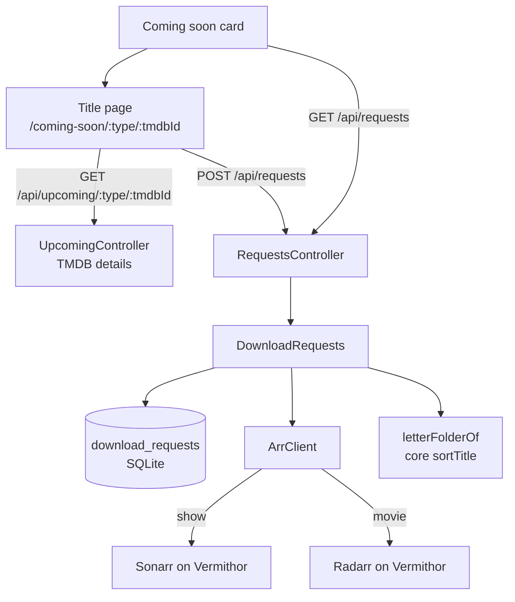
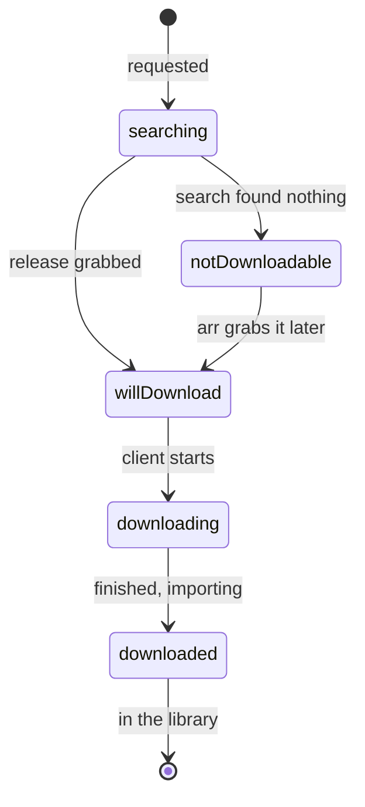
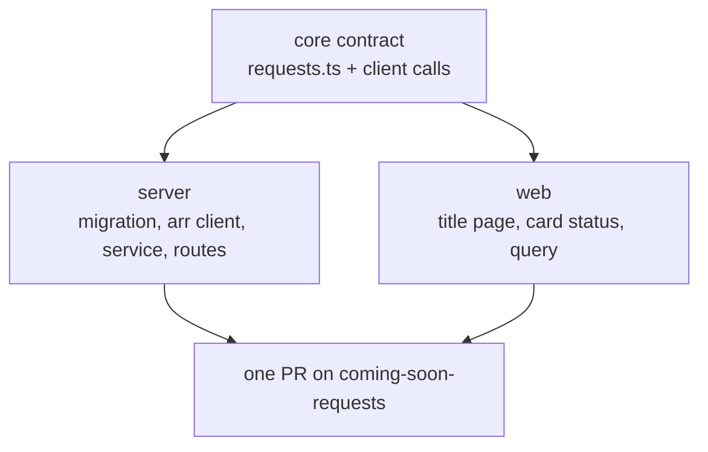

# Coming soon requests

Date: 2026-11-12. Status: built. Members ask for a title on Coming soon to be downloaded; raven hands it to Sonarr or Radarr and shows everyone how far it got.

## Why

Coming soon shelves what TMDB says is on its way, but a card only opens TMDB, and getting a title onto the server means asking the owner, who then adds it to Sonarr or Radarr by hand. The owner wants members to do that themselves, within a budget, without two people asking for the same thing, and without the owner filing it into the right letter folder afterwards.

## Goals

- A Coming soon card opens a page of its own in raven for that movie or show: its backdrop, poster, release date, summary and a Request button.
- Any approved member may request a title. One request covers everyone, since the download lands in the shared library: once a title is requested, nobody can request it again and the button says it is requested.
- Each account has a budget of 10 requests per day.
- A show goes to Sonarr and a movie to Radarr, with the API keys raven's `.env` already holds.
- The download lands in the library's own alphabet folder (`/Meleys/Movies/B`, `/Vermithor/TV/B`), filed the way the library already files titles.
- The card and the page show where a request stands:

| Status | Shown as | When |
| --- | --- | --- |
| `searching` | Searching | The arr's search command is still queued or running |
| `notDownloadable` | Not downloadable | The search finished and nothing was grabbed, queued or kept |
| `willDownload` | Will download soon | A release is grabbed and waits in the download client's queue |
| `downloading` | Currently downloading | The download client is fetching it |
| `downloaded` | Download complete, moving to library | The download finished and is importing, or the arr holds the file |

## Non-goals

Non-goals: the device app (`@raven/app`) has no Coming soon section, so it gets no request screen; cancelling or removing a request; requests for titles that are not on Coming soon; choosing a quality per request; notifying the requester when it arrives.

> [!CAUTION]
> Anti-goal: a request must never let a member reach Sonarr or Radarr directly. The browser only ever names a TMDB type and id; the server picks the folder, the profile and the arr, and never answers with an arr's address, key or paths.

## Design

### Architecture



### Server

- `requests/requestsConfig.ts` reads `SONARR_VERMITHOR_URL`, `SONARR_VERMITHOR_API_KEY`, `RADARR_VERMITHOR_URL` and `RADARR_VERMITHOR_API_KEY`, the names raven's `.env` already uses, plus `REQUEST_MOVIE_FOLDER` (default `/Meleys/Movies`), `REQUEST_SHOW_FOLDER` (default `/Vermithor/TV`), `REQUEST_QUALITY_PROFILE` (default `HD-1080p`) and `REQUEST_DAILY_LIMIT` (default 10). An arr missing its address or key is off, and requests of its type answer 503.
- `requests/arrClient.ts` is a small client for both arrs' v3 API over the injected `METADATA_FETCH`, so tests answer for them as they do for TMDB. It looks a title up by TMDB id (`series/lookup?term=tmdb:<id>`, `movie/lookup/tmdb?tmdbId=<id>`), adds it, starts a search command, and reads the command, the title and its `queue/details`.
- `requests/downloadRequests.ts` owns the table, the budget and the status. A request is taken in one synchronous better-sqlite3 transaction (budget count, then insert on the `(type, tmdb_id)` primary key), so two members pressing at once get one request and one 409. Both refusals are 409s rather than a 429, which the client would read as the rate limiter. If the arr then fails, the row is deleted again and the member gets a 502 with nothing spent.
- `requests/requestsController.ts`: `GET /api/requests` and `POST /api/requests` (`@ForViewers()`).
- `GET /api/upcoming/:type/:tmdbId` joins `UpcomingController`: TMDB's details through `TmdbClient.movie` or `.show`, the same for every viewer.

> [!TIP]
> Add with `rootFolderPath`, never `path`. Each arr then names the folder itself by its own naming format (`{Movie CleanTitleThe} ({Release Year})` in Radarr), so raven only has to pick the letter. A title already in the arr is not added again: raven records the request and starts a search for the existing entry.

> [!TIP]
> Requests download at 1080p only. Before anything is added or searched, raven reads the `REQUEST_QUALITY_PROFILE` profile from the arr and refuses (502, nothing spent) if any quality it allows is not 1080p, so a profile edited to take 4K or 720p stops requests instead of downloading them. A title the arr already holds under another profile is refused too, rather than searched at that profile's quality. Radarr is always the one on Vermithor (`RADARR_VERMITHOR_*`), never Meleys'.

### Letter folders

The library files titles under their sort title's first letter, as Radarr and Sonarr already hold them on Vermithor: "The Bear" in `TV/B`, "A Beautiful Mind" in `Movies/B`, "10 Cloverfield Lane" and "The 13th Warrior" in `Movies/#`. `letterFolderOf` takes core's `sortTitle` (leading punctuation and "The", "A" or "An" dropped), folds accents, and answers the upper case letter, or `#` for anything else. The root folder is `<base>/<letter>`, and it must be one the arr lists in `rootfolder`; if it is not, the request fails with a 502 naming the folder, and nothing is spent.

> [!IMPORTANT]
> Documentaries file by kind, not by genre: a documentary film goes to `/Meleys/Movies/<letter>` and a documentary series to `/Vermithor/TV/<letter>`, since the ask was alphabet folders. The library's existing documentary roots (`/Vermithor/Documentaries`, `/Meleys/Documentary Shows`) are flat, not lettered. Confirm or point them elsewhere with `REQUEST_MOVIE_FOLDER` and `REQUEST_SHOW_FOLDER`.

### Schema

```sql
CREATE TABLE download_requests (
  type TEXT NOT NULL CHECK (type IN ('movie', 'show')),
  tmdb_id TEXT NOT NULL,
  account_id TEXT NOT NULL,
  title TEXT NOT NULL,
  requested_at TEXT NOT NULL,
  arr_id INTEGER NOT NULL,
  command_id INTEGER,
  status TEXT NOT NULL,
  PRIMARY KEY (type, tmdb_id)
) WITHOUT ROWID;
CREATE INDEX download_requests_account ON download_requests (account_id, requested_at);
```

The row is shared, not per viewer: one request covers everyone. `account_id` only counts the budget and says `isMine`; it comes from `ViewingAccounts.keyOf`, never from the body. `status` is the last one read from the arr, answered when the arr cannot be reached.

### API

| Route | Who | Answers |
| --- | --- | --- |
| `GET /api/upcoming/:type/:tmdbId` | approved | `UpcomingDetails`: title, released, poster, backdrop, summary, tagline, genres, runtime |
| `GET /api/requests` | approved | `TitleRequests`: every request with its status, the caller's budget, which arrs are on |
| `POST /api/requests` `{ type, tmdbId }` | approved, `@ForViewers()` | the new `TitleRequest`; 409 already requested or budget spent, 503 arr off, 502 arr failed |

Each shape is a guard in `libs/raven/core/src/contract/requests.ts`, read by the server's body check and the client's calls alike.

> [!TIP]
> The budget is a rolling 24 hours, not a calendar day: the 10 requests an account made in the last 24 hours count, and the page says when the next one comes back. A calendar day needs a time zone the server does not otherwise have, and a rolling window can not be doubled up across midnight.

### Status



`GET /api/requests` reads each request's status from its arr, at most once every 30 seconds per request, and keeps the answer in the row. In order: a `queue/details` entry importing or completed is `downloaded`; one downloading is `downloading`; any other queue entry is `willDownload`; no queue entry and a file (Radarr's `hasFile`, Sonarr's `episodeFileCount` over 0) is `downloaded`; else a search command still queued or started is `searching`; else `notDownloadable`. Both arrs keep the title monitored, so a title not out yet reads as Not downloadable until its release appears, then moves on by itself.

> [!WARNING]
> Many Coming soon titles are not released yet, so most requests will read Not downloadable for weeks. That is true, and the arr keeps watching, but members may read it as final. The page's line under the status says the server keeps looking.

### Web

- `UpcomingCard` links to `/coming-soon/:type/:tmdbId` instead of TMDB, and shows the request's status under its facts when it has one.
- `UpcomingTitlePage` shows the backdrop, poster, title, release date, genres, summary, the request control and a link to TMDB. The control reads `GET /api/requests`: Request (with "N of 10 left today"), Requested by you or Requested (disabled, with the status), out of budget (disabled, saying when one comes back), or requests off.
- `requestsQuery` refetches every 30 seconds while a page that shows it is open; a request updates it at once.

## Risks

> [!WARNING]
> Sonarr and Radarr run on Vermithor and are reached by LAN address. raven on Vhagar reaches them; a dev machine's Bun may not (Local Network privacy, see the LAN relay note). Without them the page still works and says requests are off.

> [!WARNING]
> The arr keys sit in raven's `.env` on Vhagar. Vhagar's copy needs the four `*_VERMITHOR_*` lines added for requests to turn on there; nothing else changes.

## Testing

- `letterFolderOf`: articles, digits, punctuation, accents.
- `DownloadRequests` on a test database and a fake arr: a request adds with the letter root and the profile, a second for the same title is a 409, one past the budget is a 409, a failed add spends nothing, and each status the table above lists is read from the arr's answers.
- The route inventory (`ROUTES` in `src/test/enforced.ts`) lists the three routes as approved.
- Web: the card links to its page and shows a status; the page's control in each of its states.

## Order of work



One PR, one commit, on `coming-soon-requests`, together with the sign-up alert fix in `@raven/supabase`.
