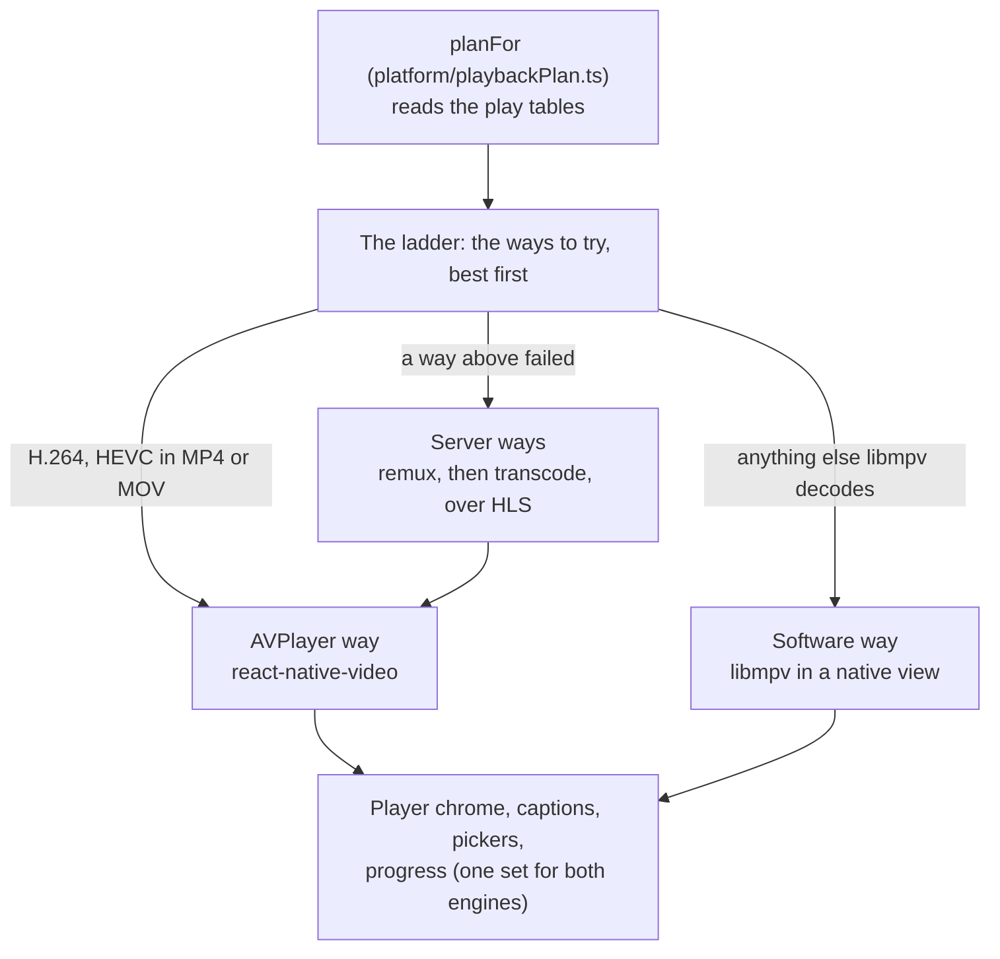
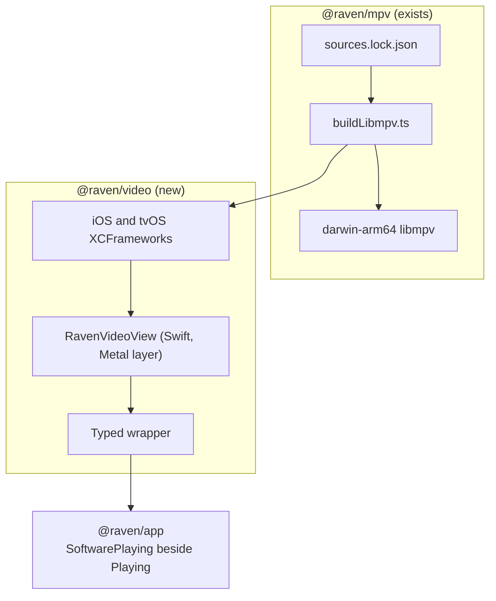
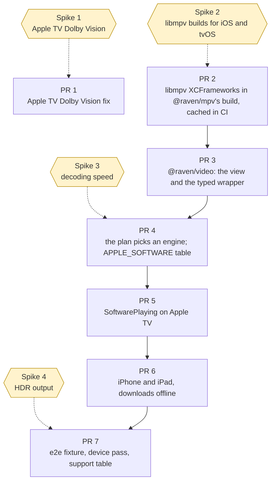

# raven app: a software player beside AVPlayer on Apple devices

Date: 2026-11-21. Status: draft, a plan only. Nothing is built and no spike has run. It is meant for a feature branch of its own, cut later.

## Why

[Which app plays which video](../../../apps/raven/docs/video-support.md) compares raven's apps with Plex's. On iPhone, iPad and Apple TV, Plex is ahead in two places:

| Gap | raven today | Plex |
| --- | --- | --- |
| MPEG-2, VC-1, VP9, AV1, VP8, MPEG-4 Part 2 and 10-bit H.264 | Transcoded on the NAS to 8-bit H.264, SDR | Played on the device |
| MKV and WebM | Remuxed by the server | Opened by the app |
| Dolby Vision on the Apple TV | Does not show (reported 2026-11-20) | Shows, from MP4 |

The cause of the first two is one fact: `@raven/app` has a single player on Apple devices, AVPlayer, which decodes H.264 and HEVC and opens MP4 and MOV, and nothing else. Plex carries a second, mpv based player that takes over for whatever AVPlayer refuses. Every such file costs raven a transcode, which is CPU heavy on the NAS (a 4K one is not practical there), loses HDR, and is capped at 1080p.

The third gap is a different problem. The server already sends the Apple TV the same `dvh1` stream the iPhone and iPad show as Dolby Vision, so something particular to the Apple TV fails. It needs a diagnosis, not a new player.

> [!NOTE]
> The Plex column of that comparison is from general knowledge of Plex's apps, not from a Plex install. The raven column is from the code. This spec leans only on the raven column: what raven's Apple apps transcode today is certain.

## Goals

1. On iPhone, iPad and Apple TV, a file whose video AVPlayer cannot decode plays on the device, from the original file, with no remux and no transcode.
2. AVPlayer stays the first player for everything it plays today, so Dolby Vision output, Picture in Picture and AirPlay are untouched for H.264 and HEVC.
3. The viewer sees one player: the same controls, subtitles in the account's look, audio and subtitle pickers, progress and resume, whichever engine is underneath.
4. The choice of engine is data in the play table, made by the same plan that picks direct, remux or transcode, so the ladder still steps down to the server when the software player fails.
5. Dolby Vision profiles 5 and 8 show as Dolby Vision on an Apple TV 4K.

Success is the Apple rows of the support table: MPEG-2, VC-1, VP9 and AV1 turn from ❌ to ✅ on iPhone, iPad and Apple TV, and the Apple TV's Dolby Vision 5 cell turns ✅.

## Out of scope

- Non-goals: replacing AVPlayer. It is the only player on Apple devices that outputs Dolby Vision, and the software player cannot.
- Non-goals: Android. ExoPlayer has gaps of its own (MPEG-2, VC-1, VP8, 10-bit H.264), but its fix is different (Media3's FFmpeg and other decoder extensions, which the patched player already uses for audio) and belongs in its own spec.
- Non-goals: the web app. A browser plays what the browser plays.
- Non-goals: Picture in Picture and AirPlay for a file on the software player. They are AVPlayer's.
- Non-goals: an App Store build. The app is still installed from Xcode, so App Store review and its rules on bundled decoders do not apply.
- Anti-goal: dropping the server's transcode. It stays the last rung of the ladder, for a device too slow to decode a file in software and for a viewer away from home over the remote limit.

## Design

### Two engines, one player

The plan gains one notion: which engine plays a direct file. Today `canPlayFor` answers yes or no from the `APPLE` table. With a second table, `APPLE_SOFTWARE`, a file AVPlayer refuses but libmpv takes is still a direct play, on the software engine.

| File | Today | After |
| --- | --- | --- |
| H.264 or HEVC in MP4 or MOV | Direct, AVPlayer | The same |
| H.264 or HEVC in MKV | Remux, AVPlayer | The same (see the review point below) |
| Dolby Vision, any container | Direct or remux, AVPlayer | The same |
| VP9, AV1, MPEG-2, VC-1, VP8, MPEG-4, 10-bit H.264 | Transcode | Direct, software engine; transcode if it fails |

> [!IMPORTANT]
> HEVC and H.264 in MKV keep going through the server's remux to AVPlayer, and do not move to the software engine. The remux is cheap, and AVPlayer gives hardware decoding, Dolby Vision, Picture in Picture and AirPlay; libmpv would open the MKV directly but lose all four. Confirm that MKV alone is not a reason to switch engines.

> [!TIP]
> The engine is chosen by the plan, per file, never by a setting the viewer has to find. A Settings row to prefer the server's transcode for software files may come later if a device proves too slow, and that is all.

### The engine: libmpv

The software engine is libmpv, the library Raven's desktop app already plays every file through.

- **The build.** `@raven/mpv` builds mpv, FFmpeg, libplacebo, dav1d and libass from pinned sources for macOS arm64 (`libs/raven/mpv/src/build/buildLibmpv.ts`, `native/sources.lock.json`). The same graph gains iOS and tvOS targets (device and simulator slices), packed as XCFrameworks. The lock, the license notices and the audit stay one system.
- **The module.** A local Expo module, as `@raven/audio` is: `libs/raven/video` (`@raven/video`), Apple only, with a native view that hosts mpv's output and a typed TypeScript wrapper. It mirrors the names of `@raven/mpv`'s wrapper where they mean the same thing (load, seek, pause, tracks, properties), so the two stay recognisable as one engine.
- **Output.** mpv draws through libplacebo into a Metal layer, as `surface_mac.mm` does on the desktop. HDR10 and HLG go out as HDR where the layer and the screen allow, and are tone mapped otherwise.
- **Decoding.** VideoToolbox for what the device decodes in hardware (AV1 on an A17 Pro or later, an Apple TV 4K has none), FFmpeg and dav1d in software for the rest.

### In the app

`src/player/Playing.tsx` drives react-native-video. A sibling, `SoftwarePlaying.tsx`, drives `@raven/video` and reports the same shared video state, so everything above it is written once:

| Concern | How the software engine meets it |
| --- | --- |
| Controls and remote keys | The same chrome and `usePlayerKeys`, fed the same state |
| Progress and resume | The same `useProgressReport` sink |
| Text subtitles | Drawn by raven's own overlay, as on AVPlayer, in the account's look; mpv's own subtitle drawing stays off |
| Picture subtitles (PGS) | The server's timed pictures, as on AVPlayer |
| Audio tracks | mpv's track list and `aid`, with no remux needed to switch |
| The source | The same ticketed file address the AVPlayer way opens; mpv asks for ranges itself |
| A lost ticket or a refused range | The same reopen from the spot, read off mpv's error |
| Failure | The ladder's reducer steps down to the transcode, as from any failed way |
| Downloads | A downloaded original plays in the software engine offline when AVPlayer would refuse it |

The component that picks between `Playing` and `SoftwarePlaying` is an object map keyed by the engine, per the repo's rendering rule.

### Dolby Vision on the Apple TV

Kept apart from the engine, since libmpv cannot fix it. What is known: the HLS master names the variant `dvh1.PP.LL` with `VIDEO-RANGE=PQ`, the remux writes the `dvcC` box, and the iPhone and iPad show the result. The first spike finds what the Apple TV does differently; the fix is then most likely in the playlist, the copy's tagging, or how the app's AVPlayer is configured on tvOS.

## Alternatives

| Option | What it is | Verdict |
| --- | --- | --- |
| libmpv beside AVPlayer | This spec. Plex's design | Chosen |
| A custom player | FFmpeg to open the file, VideoToolbox to decode, `AVSampleBufferDisplayLayer` to show it. How Infuse works | Not now, see below |
| VLCKit | VLC's library as the second player | Rejected: a third engine in the suite, weak Dolby Vision and HDR handling, and none of raven's mpv work carries over |
| KSPlayer | An open source Swift player built the custom way | Rejected: GPL or a paid licence, and a dependency raven would not control |
| Stay on the transcode | Do nothing | Rejected: it is the gap |

### Why not the custom player

It is the better end state on paper: one player instead of two, real Dolby Vision straight from MKV, hardware AV1 with HDR intact. It is not advised as the first step for these reasons:

1. **It is a video pipeline, not a feature.** raven would own demuxing, decoder selection, the hand-off of compressed frames to VideoToolbox, software frames converted to pixel buffers, audio decoding and output, audio and video sync, seeking, buffering and HDR metadata. mpv is twenty years of exactly that code. Each of those parts fails in ways that only show on certain files.
2. **Nothing raven has carries over.** The libmpv build, its lock, its audit and the desktop's experience with mpv's behaviour all apply to the libmpv route and to none of this one.
3. **The gain is narrower than it looks.** Its one advantage over the two engine design is Dolby Vision and Picture in Picture for files AVPlayer cannot open. raven's server already remuxes Dolby Vision MKV to a `dvh1` stream AVPlayer plays, which is something Plex does not do, so that case is covered today. What is left is Dolby Vision in AV1 (profile 10), which is rare.
4. **It can come later without waste.** The plan's engine choice, the shared player state and the `SoftwarePlaying` seam are the same for a custom engine. If the two engine design shows a real limit, a custom engine replaces libmpv behind that seam.

> [!IMPORTANT]
> Confirm libmpv beside AVPlayer over the custom player. The custom player is roughly several times the work for a gain raven's remux already covers; it stays open as a later replacement behind the same seam.

## Spikes

Each spike is a throwaway, run before the PR it unblocks.

1. **Apple TV Dolby Vision.** Play checklist files M3 (profile 8.1) and M4 (profile 5) on the Apple TV 4K at home and on an iPhone, direct and through the remux. Read AVPlayer's access log and the variant it picked, check the TV's Match Dynamic Range setting, and compare with a known good Dolby Vision HLS stream. Go if the cause is found and is in raven's hands; no-go, and a note in the support table, if the TV or tvOS refuses what the iPhone accepts.
2. **libmpv on tvOS and iOS.** Build mpv, FFmpeg, libplacebo and dav1d for the tvOS and iOS device slices from the existing lock, and draw one VP9 file in a bare Xcode app. Go if it builds from the pinned sources with patches small enough to keep, and plays with sound.
3. **Software decoding speed.** On the Apple TV 4K and the oldest iPhone the app supports, play 1080p and 4K files in AV1, VP9, MPEG-2 and VC-1 and read dropped frames. Go if 1080p plays clean in every codec; the result sets the table's limits (a 4K AV1 file on an Apple TV may stay a transcode).
4. **HDR out of the software engine.** Play checklist files M8 (AV1 HDR) and M9 (VP9 HDR) and see whether the Metal layer puts out HDR on the Apple TV and an iPhone. Go either way: the result decides whether the support table says HDR or tone mapped for the software engine.

## Risks

> [!WARNING]
> Software decoding of 4K AV1 or VP9 may be too slow on an Apple TV 4K, which has no AV1 decoder in hardware. Spike 3 measures it; the table can keep such files on the transcode by resolution.

> [!WARNING]
> The app grows by the size of FFmpeg, mpv and libplacebo, likely tens of megabytes per platform. That is acceptable for an app installed from Xcode, but it lengthens every native build in CI.

> [!WARNING]
> The native CI jobs get slower. Building libmpv for four more slices must be cached as the macOS build is, or the `📱 App on iPhone and iPad` and `📺 App on Apple TV` jobs will not fit their budgets.

> [!WARNING]
> Two engines means two sets of device behaviour to keep in step: seeking, buffering, track switching, the reopen after a lost ticket. The render tests cover the shared chrome, but only a real device shows an engine's faults.

> [!WARNING]
> mpv's licence. The desktop build ships mpv under the GPL with a source offer. A sideloaded app has the same duty: the sources tarball and notices must cover the iOS and tvOS builds too.

> [!CAUTION]
> Do not route Dolby Vision to the software engine, on any profile. libplacebo makes the colours right but outputs HDR10 or SDR, never Dolby Vision, so it would turn a ✅ into a lesser picture without any error to notice.

## Testing

- **Core and the plan (bun).** `canPlayFor` and `planFor` for every codec and container on each Apple platform: which engine, and the ladder behind it. Dolby Vision never plans to the software engine.
- **The wrapper (bun).** `@raven/video`'s typed wrapper against a fake native module, as `@raven/mpv`'s is tested.
- **Screens (jest-expo).** `SoftwarePlaying` renders the same chrome, pickers and captions as `Playing` from the shared state, and a failure steps the ladder down.
- **End to end.** One Maestro flow on the iPhone simulator and one XCUITest on the Apple TV simulator play a VP9 fixture through the software engine and assert the clock runs. The fixture server gains that one clip.
- **Devices.** Rows M8 to M13 of the [device checklist](../../../apps/raven/app/docs/device-checklist.md), on an iPhone, an iPad and the Apple TV 4K, since no simulator decodes like a device or shows HDR.
- **The document.** Each PR that changes a play table changes [the support table](../../../apps/raven/docs/video-support.md) with it.

## Order of work

Each PR stays between 10 and 50 files and builds on the one before.

| Step | What lands | Depends on |
| --- | --- | --- |
| PR 1 | Whatever spike 1 finds: the playlist, the copy's tags or the tvOS player setup. Independent of the rest | Spike 1 |
| PR 2 | iOS and tvOS targets in `buildLibmpv.ts`, the lock and the audit; a cached CI step | Spike 2 |
| PR 3 | `libs/raven/video`: the Expo module, the Metal view, the wrapper and its tests | PR 2 |
| PR 4 | `APPLE_SOFTWARE` in `canPlay.ts`, the engine in the plan, limits from spike 3 | PR 3, spike 3 |
| PR 5 | `SoftwarePlaying` behind the shared chrome on Apple TV: keys, captions, tracks, progress, reopen | PR 4 |
| PR 6 | The same on iPhone and iPad, and a downloaded original played offline | PR 5 |
| PR 7 | The e2e clip and flows, the device checklist rows, the support table's Apple cells | PR 6, spike 4 |

> [!IMPORTANT]
> Apple TV first, then iPhone and iPad. The Apple TV is where a transcode hurts most (a big screen, 4K files) and where the Dolby Vision gap is. Confirm that order, or put the iPhone first because it is the easier device to debug.
