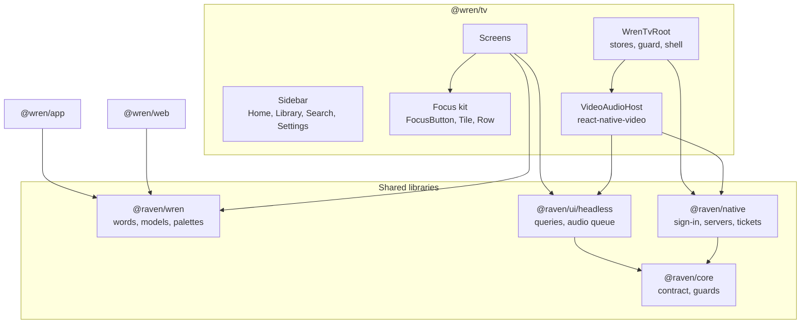
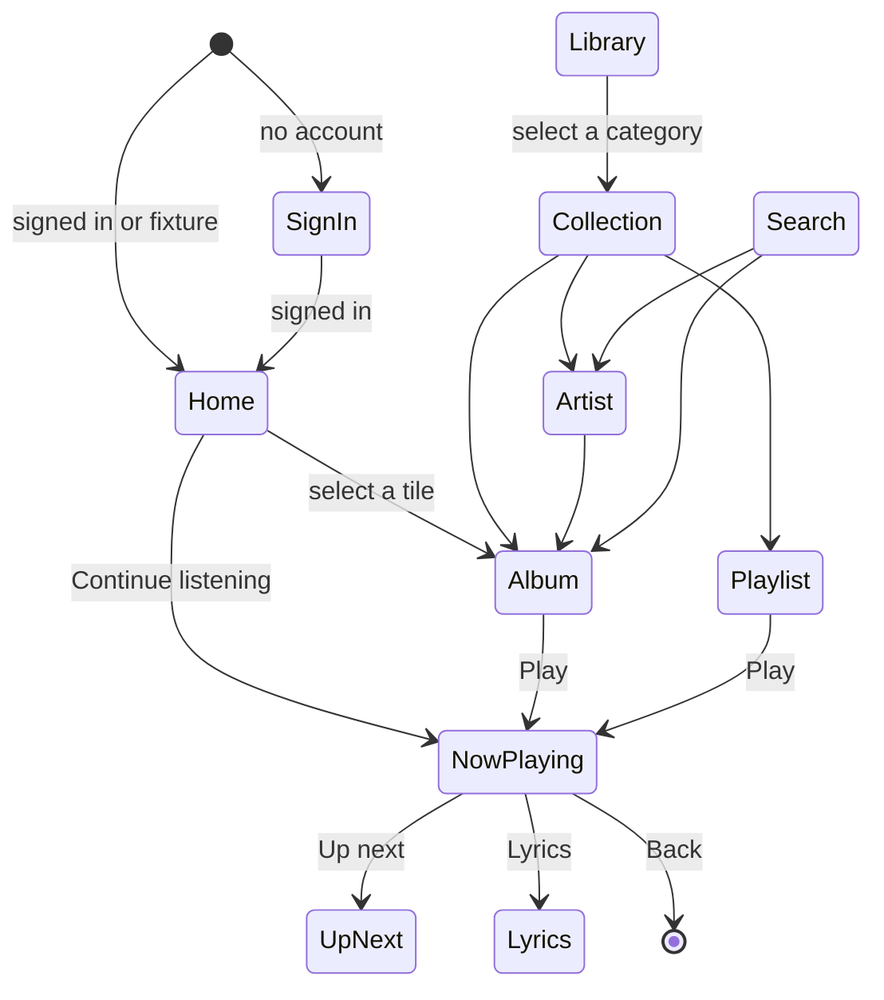
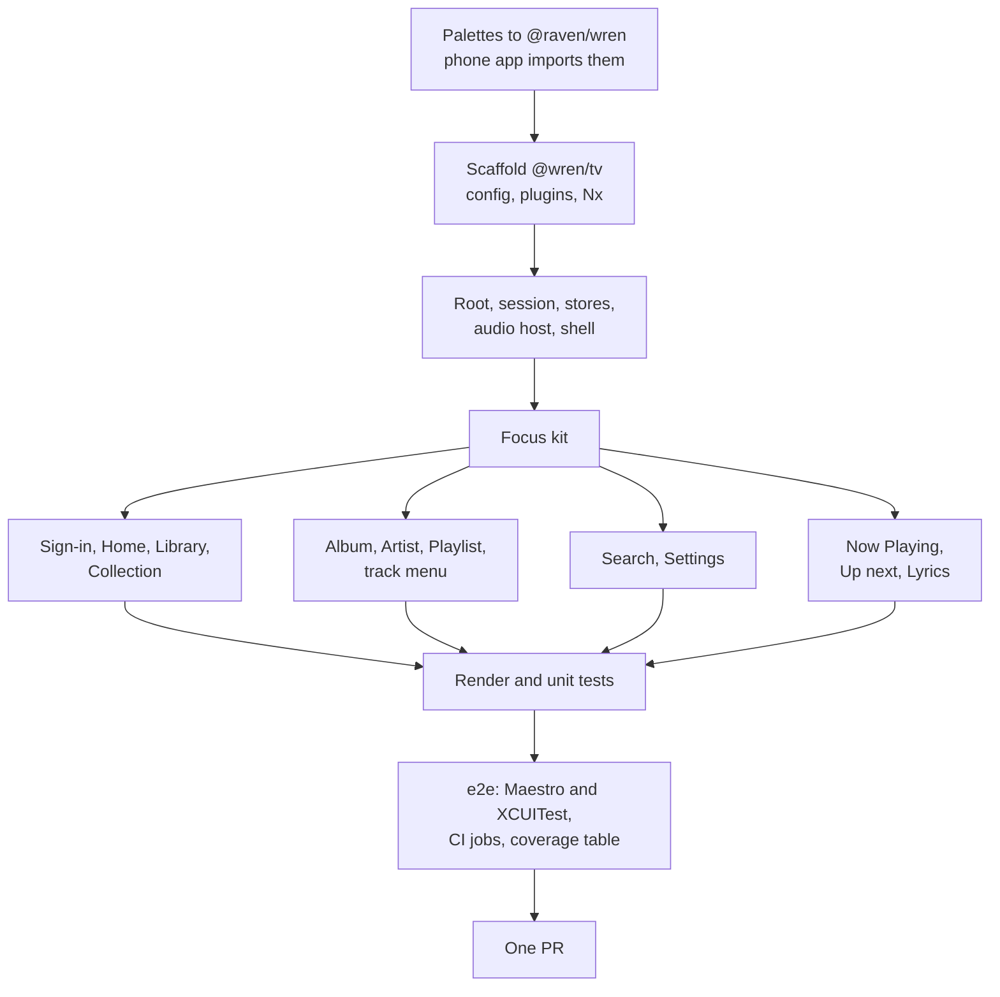

# Wren on Apple TV and Android TV

Date: 2026-11-26. Status: approved. Wren, raven's music app, gains a fourth and fifth home: the living room's Apple TV and Android TV, as one new Expo app, `@wren/tv`, driven by the remote, with the same screens, words, order and themes as Wren on the phone, the tablet and the web.

## Why

Wren plays raven's music on an iPhone, an iPad, an Android phone and in a browser. The house's TVs (the Apple TV and the Google TV Streamer) already run raven for video, and music is the one thing they cannot play the Wren way: raven's TV app shows albums inside a video app's layout, with raven's look, not Wren's. A listener who picks an album on the phone and then sits on the sofa should find the same Home, the same Library categories and the same Now Playing on the TV.

> [!NOTE]
> raven's device app (`@raven/app`) already ships on both TVs from one Expo project on the `react-native-tvos` fork, with `EXPO_TV=1` prebuilds, Maestro flows for Android TV and an XCUITest for Apple TV. Wren on TV follows that toolchain step for step, so nothing about building, signing or testing is new.

## Goals

- One app, `@wren/tv` in `apps/wren/wren-tv`, built for Apple TV (tvOS) and Android TV from the same sources.
- Feature parity with every other Wren: the same routes (Home, Library and its categories, Search, Settings, an album, an artist, a playlist, Now Playing, sign-in), the same words (every one from `@raven/wren`), the same themes (the nine palettes), the same sorts, counts, notices and track menu.
- Driven by the remote: every control is reachable by the focus engine, the focus is drawn plainly from across the room, Back (Menu on Apple TV) leaves a page, and play and pause answer the remote's own key.
- Unit tests under bun for every pure rule the app adds, render tests under jest-expo for every screen, and end to end tests on both TVs against the fixture server.
- The parity agents and the e2e coverage table know the TVs.

## Non-goals

Non-goals: downloads, CarPlay and Android Auto, the cellular quality, a drag to reorder Up next, a background audio session and the lock screen. A TV keeps no library of files, has no car and no mobile network, and a remote has no drag; each is an allowed difference, listed in the app's `CLAUDE.md`.

> [!CAUTION]
> Anti-goal: a second copy of Wren's words or rules. A label, a count, a sort or a notice that the TV needs and `@raven/wren` lacks goes into `@raven/wren` with its test, never into the TV app alone. A TV screen that says something the phone does not is drift.

## Approaches

| Approach | What it means | Trade-off |
| --- | --- | --- |
| A. TV layouts inside `@wren/app` | `EXPO_TV=1` prebuilds of the phone app, a focus variant of every screen picked by `Platform.isTV` | One project, but Wren's touch kit (reanimated sheets, gesture-handler drags) would have to grow a second variant of each of its ~100 components, and the phone app's native config (CarPlay, Android Auto, background audio) would need a TV branch everywhere |
| B. A separate app, `@wren/tv` (picked) | Its own routes, shell and focus kit, reading `@raven/wren`, `@raven/native` and `@raven/ui/headless` as the phone app does | Some hooks are written again for the remote, as Wren on the web already writes its own; the native config stays simple, since every build is a TV build |
| C. Wren screens inside `@raven/app` | A music mode in raven's TV app | Wren's look and raven's would share a shell; the phone and web Wrens are apps of their own, so the TV one would be the odd one out |

> [!TIP]
> B, because it matches how Wren already ships twice (`@wren/app` and `@wren/web` share `@raven/wren` and write their own hooks and kit), it keeps the phone app untouched but for one move of shared data, and every build of it is a TV build, so no screen ever asks which device it is on.

## Design

### Architecture

- **Routes.** `app/` holds the same route files as `@wren/app` (`(tabs)/index`, `library`, `search`, `settings`, `album/[id]`, `artist/[id]`, `playlist/[id]`, `collection/[kind]`, `now-playing`, `sign-in`), and `src/parity.test.ts` fails when the two sets differ. The `(tabs)` group is a stack screen whose layout draws the sidebar beside a `Slot`, since a TV has no tab bar.
- **Shell.** A sidebar along the left edge, as raven's TV app and Wren's tablet have: the lockup, the four places with their icons, and the playing song as a row that opens Now Playing. It folds to icons once the focus leaves it, and opens again when the focus comes back.
- **Focus kit** (`src/ui/`): `Focusable` (a `Pressable` that draws a ring and a lift when focused, with `hasTVPreferredFocus` for the first control of a screen), `FocusButton`, `AlbumTile`, `ArtistTile`, `ListRow`, `SongRow`, `Shelf` (a horizontal `FlatList`), `TileGrid` (a `FlatList` of `numColumns`), `ChoiceRow` (a row whose press cycles through or opens a list of choices), `Sheet` (a centred panel over a scrim, for a track's menu and choices), `EmptyState`, `QualityChips`, `WrenLockup`.
- **Sizes.** The TV's own `TV_SIZES` and type scale, made for a 1920 by 1080 point screen read from across the room and scaled to the screen (`tvSize`), beside the palettes every Wren shares.
- **Theme.** The nine palettes move from `@wren/app`'s `wrenTokens.ts` to `@raven/wren` (`WREN_PALETTES`, `BRAND`, `ART`, `ON_PICTURE`, `Palette`), since they are platform-free data; the phone app imports them from there, and the TV app does too. Settings' Appearance keeps the same `ThemeChoice`.
- **Music.** The shared `useAudioQueue` holds the queue; `VideoAudioHost` plays it through `react-native-video` out of sight, one track at a time from its ticketed address, as raven's TV app plays music. `@raven/audio` is linked through `@raven/native` but never called; the Android TV manifest drops its media service (`withoutTvAudioService`). The remote's play and pause key plays and pauses anywhere (`useTVEventHandler`).
- **Sign-in.** `@raven/native/headless`'s `signInFlowFor`, the same steps and errors as every app, with the TV's keyboard for the email and the password.

### The user's flow

### Screens

| Screen | What it shows on TV | Allowed difference |
| --- | --- | --- |
| Sign-in | The lockup, Email, Password, Sign in, the error in `@raven/wren`'s words | None |
| Home | Greeting, Continue listening, the shortcuts (Shuffle all, Favourites, Recently finished), the recent albums grid with its Date added or Latest release choice | No Downloads shortcut, no "Play your downloads" |
| Library | `LIBRARY_ORDER`'s categories with their counts | No Downloads category |
| Collection | Albums (sort, cover size), Artists, Playlists (New playlist), Unmatched, In progress, Favourites, Recently finished, Songs (sort, paging) | No A to Z rail; the remote scrolls the grid |
| Album, Playlist | The head (cover, title, facts, Play, Shuffle, Like, More) beside the tracks | No Download button |
| Artist | The photo, the name, Follow, Play, the albums | None |
| Search | The field (the TV's keyboard), the filters, the results, recent searches, Browse | Browse has no Downloaded tile |
| Settings | Account and Sign out, the server, Appearance, Library, About | No downloads group, no cellular quality |
| Now Playing | The cover, the song, its heart and Add to playlist, the quality chips, the scrubber (left and right seek), Previous, Play or Pause, Next, Shuffle, Repeat, and a pane of Up next or Lyrics | No volume (the TV's own), no Output, Up next moves a song with Move up and Move down |

> [!TIP]
> The TV's Up next moves a song with Move up and Move down, and takes it off with Remove, as Wren on the web already does with its buttons, instead of a drag and a swipe. The TV and the web read the same there.

> [!IMPORTANT]
> Wren on TV gets its own bundle id and package, `app.netlify.wren.tv`, so it installs beside raven and beside a phone Wren signed with the same team. Overrule this if the TV build should share `app.netlify.wren` with the phone app.

## Testing

- **Unit, bun** (`*.test.ts`): the TV sizes' scaling, the sidebar's places and their order, the route parity with `@wren/app`, the app config (bundle ids, the TV plugin, the banner and icons), the config plugins, the remote's key map, the grid's columns, the focus kit's helpers and the stores (prefs, recent searches).
- **Render, jest-expo** (`*.render.test.tsx`): every screen renders its states (loading, empty, failed, ready) from `@raven/ui/headless` fixtures, the sidebar and the focus kit; `react-native-video` is mocked.
- **End to end, Android TV:** Maestro flows driven only by `pressKey: Remote Dpad ...`, against `serve:fixture` on the `raven_tv` AVD: open on Home with Morning Chorus under Recently added, open it, play it, read the first track off the sidebar's playing row, press Next, open Library's Albums, and search for the album.
- **End to end, Apple TV:** an XCUITest (`tvos-e2e/WrenRemoteFlowTests.swift`) driven by `XCUIRemote`, added to the generated project by `plugins/withTvRemoteTests.ts`, the same steps, since Maestro cannot drive tvOS.

> [!WARNING]
> The end to end suites need a Mac with Xcode, the tvOS simulator and the Android TV emulator, as raven's do, so `verify` leaves them out and CI runs them on main only (`e2e-tests.yml`).

## Risks

> [!WARNING]
> `@raven/audio` links on every Apple build through `@raven/native`. raven's tvOS build already compiles it, so this is a known quantity, but a tvOS-only API change there would now break two apps.

> [!WARNING]
> The PR is large for a new app (about a hundred files). It stays one PR because an app with half its screens would not be shippable; it is grouped by area in the description so it reads in order.

## Order of work

